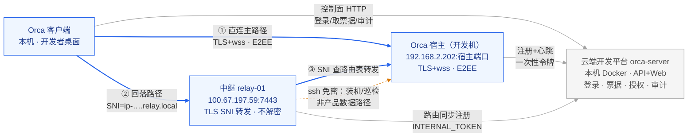

# 真实链路部署方案（M114：客户端 → 中继 → 平台 → 开发机）

> 链路：**客户端**=本机 Orca；**中继**=100.67.197.59；**云端开发平台**=本机 Docker 容器；
> **开发机**=内网 192.168.2.202（中继免密 `ssh 202` 可登录）。
> 与既有架构的关系：平台 / 中继 / 宿主三角色本就独立部署，本方案只是给它们分配真实机器。

## 0. 节点注册模型（需求确认 2026-11-14）

- **开发机**与**中继**都是**主动注册**节点：开发机启动后持一次性令牌调 `/v1/hosts/register` 并持续心跳（M107）；中继启动后向 `/v1/internal/relay-endpoint` 路由同步注册、窗口期外自动剔除（M83）。
- 平台**只登记与分配**节点：把直连/中继端点与凭证下发给客户端，从不代理业务流量（M85 全字节验证平台跳 0 字节）。
- 客户端**直连中继**：数据路径 客户端 → 中继 → 开发机，端到端 E2EE 不变。
- 中继与开发机**分开管理**：管理台各自独立页面与接口（`/v1/relays` ≠ `/v1/hosts`），不混排。

### SNI 不依赖域名（澄清）

开发机没有域名不影响 SNI 路由：SNI 在这里只是**路由标签**。平台为每台宿主分配 `routeKey`（**默认=直连 IP**，形如 `ip-192.168.2.202`——内网主机名不可靠；显式配置优先，且随宿主直连 IP 变化自动跟随），connect 响应给客户端的中继端点形如 `{url: 'wss://<中继地址>:<端口>/', sni: 'ip-192.168.2.202.relay.local'}`；客户端用 Node 的 `tls servername` 把这个字符串显式写进 ClientHello（与拨号 IP 无关，无任何 DNS 解析）；中继解出字符串查路由表转发到 `192.168.2.202:<端口>`。`.relay.local` 仅是可读后缀。

### 已修复的实现缺口（M114-1）

真实链路暴露：中继注册原只上报 `{id, port}`，平台把端点拼成 `wss://127.0.0.1:<port>`——跨机部署时客户端会拨自己。修复：注册体增加 `host`（`RELAY_PUBLIC_HOST` 显式配置，缺省取注册来源 IP），平台端点改用该地址。原以为需要域名的 SNI 疑虑同上澄清。

## 1. 拓扑

> 可编辑源图：[`deployment-real-link.drawio`](./deployment-real-link.drawio)（draw.io / diagrams.net 打开）。

- **① 直连优先**：同网段可达 202 时直接 TLS+wss，端到端 E2EE（D4，M90）。
- **② 回落中继**：直连探测失败后按平台下发的中继端点逐个尝试（AC-23：单中继宕机自动切换）。
- **③ 中继转发**：按 TLS ClientHello 的 **SNI**（路由键标签，默认=`ip-<直连IP>.relay.local`）查表转发，无解密能力（M10/M86）。
- **平台只做控制面**（登录/票据/授权/审计），永不进入数据路径（D1，M85 已验证 0 字节）。
- **ssh 虚线**是运维通道（装机/巡检），不属于产品数据路径。

## 2. 环境清单与前置条件

| 角色 | 位置 | 需要 |
|---|---|---|
| 平台 | 本机 Docker `orca-server` | 暴露端口（如 18787→容器 18787）；镜像构建见 `~/.claude/.../docker-orca-server-150220.md` 配方（node 直跑亦可：`node cloud-platform/apps/api/src/server.ts`） |
| 中继 | 100.67.197.59 | Node ≥22.18 + 仓库代码（或镜像）；`API_URL` 指向本机平台地址、`INTERNAL_TOKEN` 与平台一致、`PORT` 对客户端可达 |
| 开发机 | 192.168.2.202 | 安装 Orca 桌面/server 版；env：`ORCA_CLOUD_API_URL`、`ORCA_CLOUD_HOST_TOKEN`、`ORCA_CLOUD_HOST_NAME`、`ORCA_CLOUD_ADVERTISE_HOST=192.168.2.202`、`ORCA_CLOUD_PROJECTS_ROOT`、`ORCA_CLOUD_TLS_CERT_PATH/KEY_PATH`（自签）；**202 必须能反连本机平台端口** |
| 客户端 | 本机 Orca | `ORCA_CLOUD_API_URL` 指平台、`ORCA_CLOUD_TLS_INSECURE=1`（自签阶段） |

前置检查：本机 ↔ 100.67.197.59 端口通；本机 ↔ 202 通（直连数据面）；202 → 本机平台端口通（心跳/取票据）；
`ssh 202` 免密已配。**中继与 202 都在远端网段，平台地址必须用二者可达的本机 IP，不能写 localhost。**

## 3. 部署步骤（一次链路的建立）

1. **平台**：本机启动 orca-server（docker 或 node），确认 `[api] listening`；管理员登录签发
   宿主令牌 `POST /v1/hosts/tokens`（一次性、24h）。
2. **中继**：管理台「中继」页 →「添加中继」向导复制一行命令（`bash <(curl -fsSL http://<平台>/install/relay.sh?…)`，内嵌平台地址与内部令牌）到 100.67.197.59 执行；等 `[relay] routes synced`，
   平台 `/v1/internal/relays` 应显示该节点 online（M10/M83 的判定方式）。
3. **开发机 202**（经 `ssh 202`）：管理台「主机」页 →「注册主机」向导复制一行安装命令执行（内嵌一次性令牌；自签证书由脚本生成或按提示放置）→
   平台 `/v1/hosts` 出现该主机且 `online=true`、`directAddrs=[192.168.2.202:<port>]`、
   `e2eePublicKey`/`tlsFingerprint` 非空（M107/M108 的就绪判据）。
4. **登记项目**：管理员 Web 建项目（hostId=202 主机、path=202 上的仓库路径）+ 授权组
   （或 202 配 projectsRoot 走开发者自助）。
5. **客户端**：本机 Orca 登录 → 打开项目 → 预检应选中**直连**（本机→202 可达）；
   工作区标题显示「直连 + 延迟」。
6. **回落演练**：阻断本机→202 的直连（如断开该网段/防火墙），重开项目 → 自动走中继
   （SNI=`ip-192.168.2.202.relay.local` 路由标签），徽标变「中继」；连接诊断面板应列出两种地址的探测结果。

## 4. 在此链路上要测什么（映射到 test-plan）

| 项 | 环境 | 用例/判据 |
|---|---|---|
| 真实 WAN/内网 RTT 下的全部 §5.1 预算 | 本链路 | 复跑 M102–M106 口径（回显 ≤120ms、建连 ≤2s/3s 等），替换“本机回环”限制 |
| AC-22 生产容量口径 | 同上 | `load-300.test.ts` 指向真实平台/中继/宿主 |
| AC-32 WAF/DMZ | 需在平台前加 WAF | 管控接口被拒、工作台不受影响（仍待环境） |
| 中继多节点负载/切换 | ≥2 个中继节点 | AC-23 用例指向真实中继；可选增强：客户端按探测延迟选最快中继 |
| 真实证书链 | 平台 CA 签发 | 撤掉 `TLS_INSECURE=1`，验证宿主 TLS 链 + 指纹固定（M109） |

## 4b. 浏览器经中继使用 Web 界面（M121/M122，修订）

**与客户端连接的本质差异**：桌面客户端（Node TLS）把「拨号地址」与「TLS 身份名」解耦——直拨中继 IP:端口、用 `servername` 显式写任意 SNI 标签，且用 TOFU 指纹固定宿主身份（自签证书即可）。浏览器两者绑死：SNI=URL 域名=DNS 解析目标，证书必须过浏览器信任链。这就是「桌面经中继零配置、浏览器经中继需要改造」的根因。

**修订方案：中继双模式（替代通配 DNS + 逐宿主证书方案）**

- **桌面模式（现状不变）**：SNI 透传，`ip-*.relay.local` 标签路由，宿主自签证书 + 客户端指纹固定。
- **浏览器模式（新增）**：中继用**自己的单域名证书**（企业 CA 或 Let's Encrypt，一份证书）终结传输层 TLS，按 URL 路径 `/h/<routeKey>/` 把 HTTP/WSS 转发到对应宿主。外网浏览器无需任何 DNS/hosts 配置，也无需宿主证书公网可信。
- **保密性语义（如实声明）**：E2EE 是应用层端到端（客户端↔宿主 nacl box），中继终结的只是传输层 TLS——它可见 URL 路径与头部，**仍不可读**终端/文件/agent 载荷（AC-24 的抓包判据保持）。设计文档与审计页需写明中继「浏览器模式终结传输层 TLS」。
- **备选**：企业可控泛域名时，可退回纯透传方案（通配 DNS + 平台 CA 逐宿主签 `<routeKey>.<域名>` SAN 证书）；routeKey 随 IP 变化时需重签证书，这是该备选的固有成本。

**自动进入工作区（M122）**：平台项目行「Web 打开」→ 平台签发一次性短 TTL handoff code → 新标签 `<web入口>#handoff=<code>&project=<id>` → orca web 以 code 换会话（令牌不经 URL）→ 自动打开该项目工作区；code 失效回落登录表单。

## 5. 已知限制 / 风险

- 平台跑在本机 Docker：本机休眠/网络切换 = 全链路控制面下线；仅作联调，不作长驻。
- 202 为内网地址：直连仅在与其同网段的客户端可达；跨网段客户端天然走中继（这正是回落路径）。
- 自签证书阶段两端需 `TLS_INSECURE=1`；指纹固定（M109）仍生效，因它不依赖 CA。
- ssh 202 的免密通道用于装机/巡检，不进入产品数据路径。
