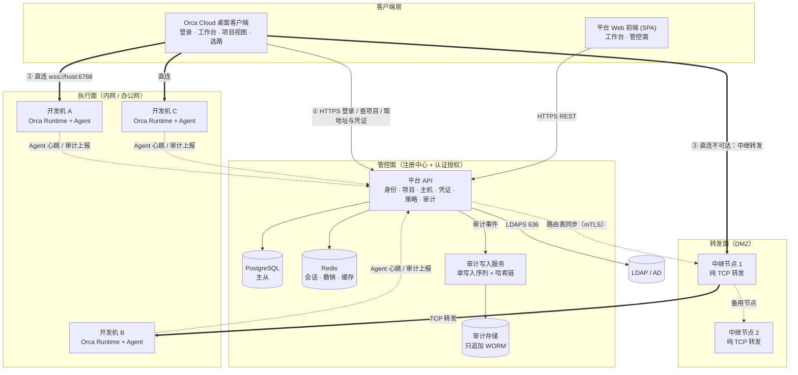
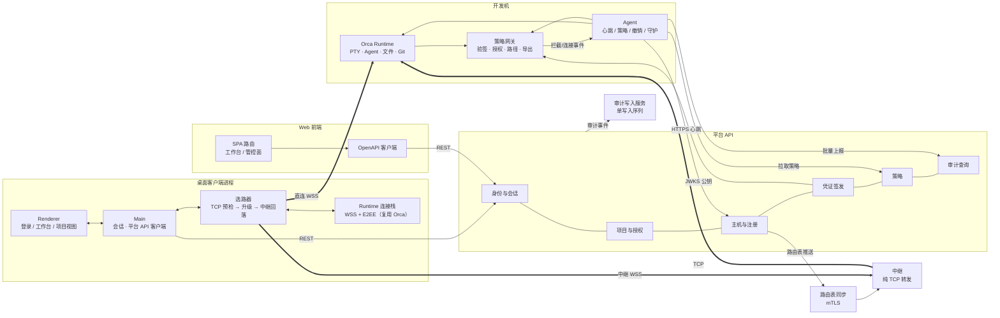
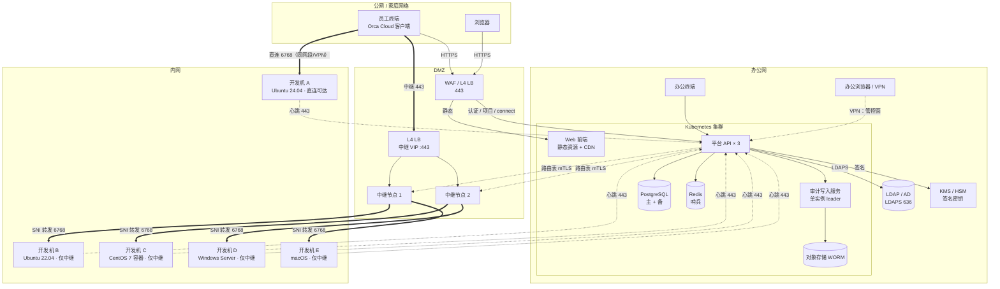
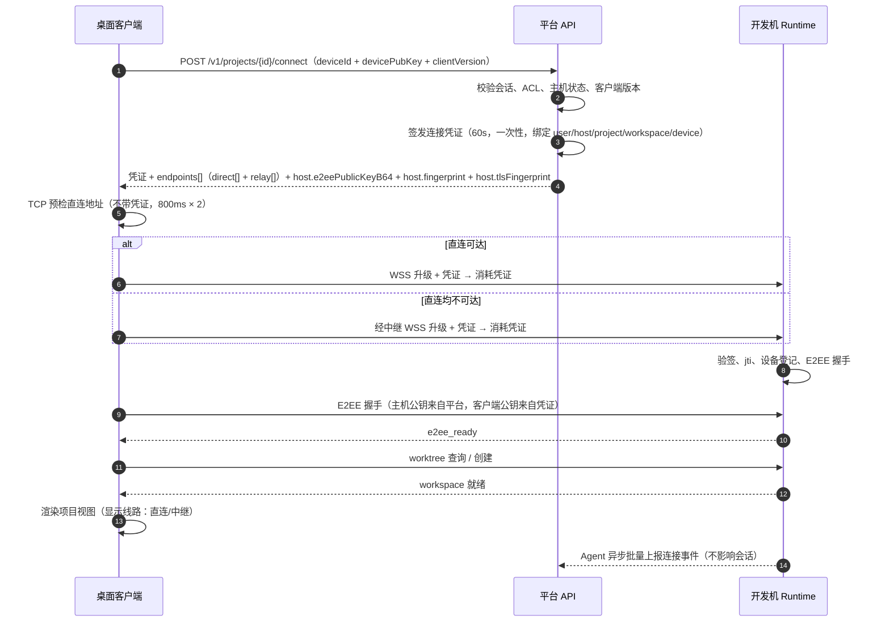
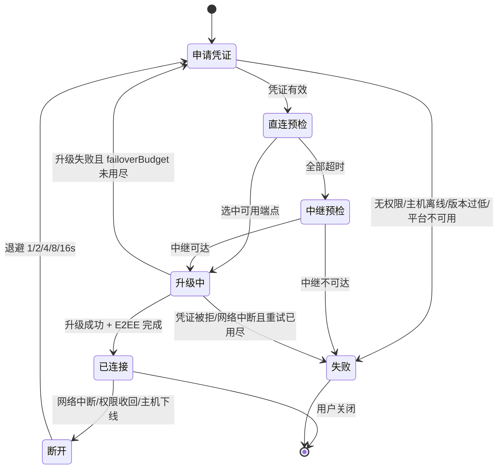
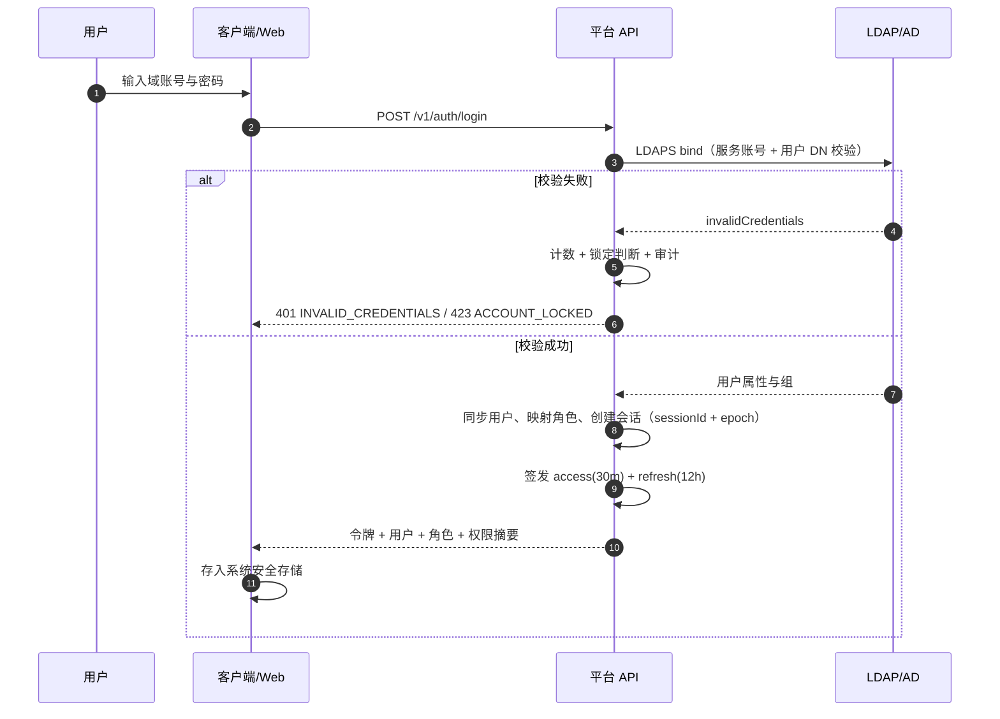
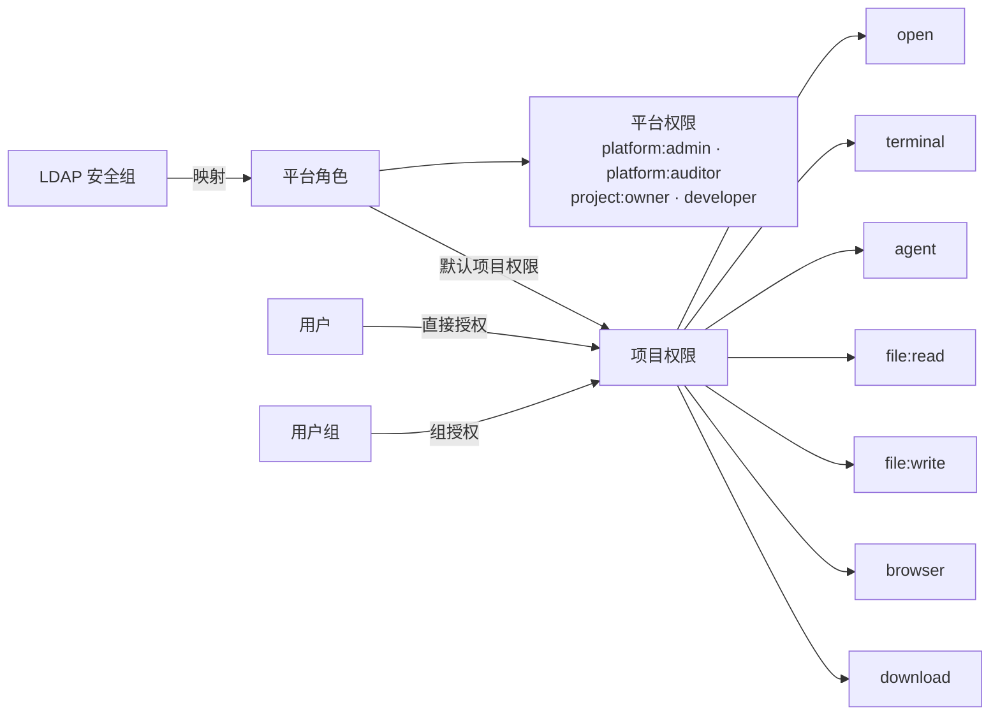
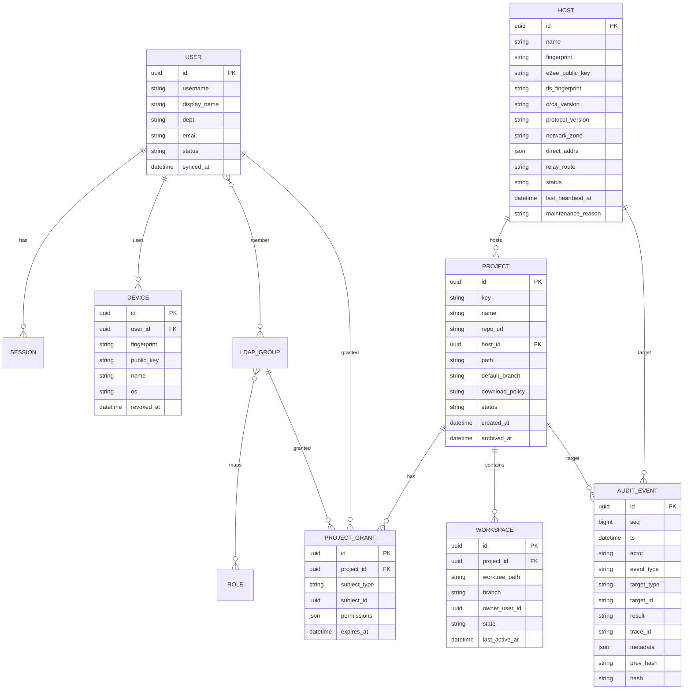
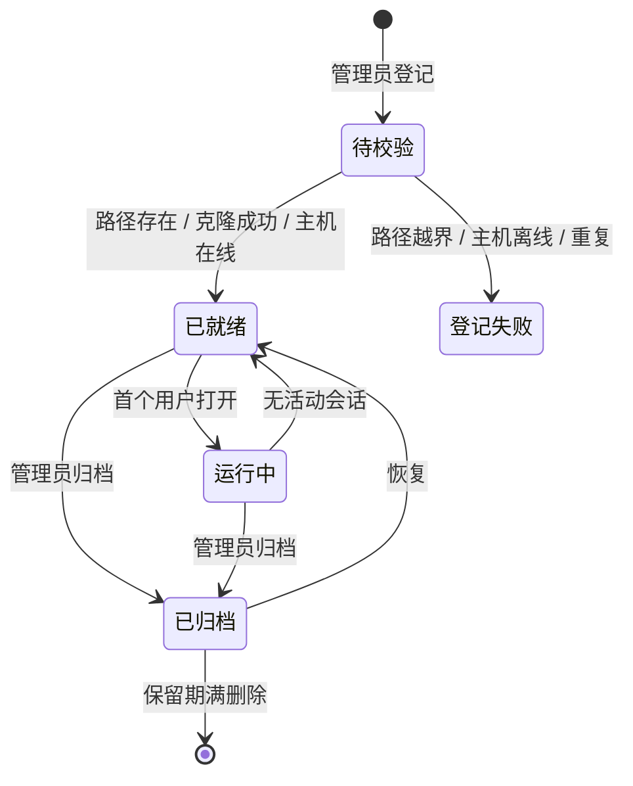
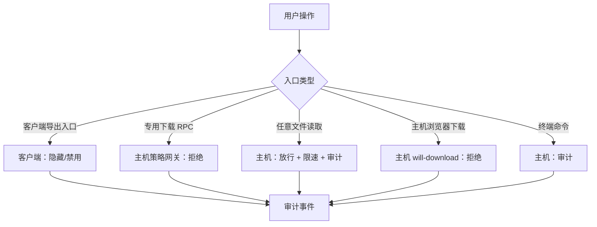

# Orca Cloud 云端开发平台 — 总体设计

> 版本：1.3（2026-11-14）
> 状态：评审修订中
> 需求基线：[requirements.md](./requirements.md)（v1.2）
> 原型：[ui/prototype.html](./ui/prototype.html)
> 图表：[diagrams.html](./diagrams.html)
> 评审记录：[reviews/design-review-01.md](./reviews/design-review-01.md)

---

## 1. 设计范围

本文覆盖一期（MVP）的总体架构、组件、连接、身份权限、数据、安全、部署与演进。不覆盖具体代码实现细节，实现任务见 [tasks.md](./tasks.md)。

**一句话架构**：平台是**注册中心 + 认证授权中心**，不承载业务流量。客户端登录平台 → 查询项目 → 拿到该项目的开发机地址（直连地址列表 + 中继端点列表）与**短期连接凭证** → 自行探测直连，不通再连中继；连接建立后客户端与开发机之间的 Orca E2EE 会话完全绕开平台。中继只做 TCP 转发，不解析、不解密、不鉴权。

---

## 2. 现状与差距

### 2.1 可直接复用的能力

| 能力 | 现状 | 复用方式 |
|---|---|---|
| Orca Runtime | `orca serve` / orcad 无头运行，`src/main/orcad/orcad-entry.ts` | 原样作为开发机运行时 |
| WSS + E2EE | `src/main/runtime/rpc/ws-transport.ts`、`src/main/runtime/rpc/e2ee-channel.ts` | **不改协议**；中继只是一段链路 |
| E2EE 握手 | 客户端发 `e2ee_hello{publicKeyB64}`，主机回 `e2ee_ready`，客户端发 `e2ee_auth{deviceToken,...}` | 不变；设备准入改由升级期凭证完成 |
| 端口与配对 | 默认 `6768`，`src/main/runtime/runtime-rpc/runtime-rpc-pairing-types.ts:17` | 沿用端口；托管模式不再用配对链接 |
| 设备令牌 | `src/main/runtime/device-registry.ts`、`runtime-rpc-pairing.ts` | 增加平台托管来源的程序化登记 |
| RPC 权限 | `src/main/runtime/rpc/rpc-method-permission.ts`、`rpc-caller-scope.ts` | 新增方法级权限映射（现状仅 `workspace` 粗粒度） |
| 文件 RPC | `src/main/runtime/rpc/methods/files-mutation-methods.ts`、`files-params.ts` | 增加导出拦截与路径边界 |
| 项目视图 | 标签页/分屏/终端/编辑器/浏览器，`TerminalSurface.tsx`、`TabGroupPanel.tsx` | 原样保留 |
| 文件浏览器 | `src/renderer/src/components/right-sidebar/FileExplorer.tsx` | 保留，注入策略状态 |
| 协议版本 | `src/shared/protocol-version.ts`（v3，最低 v2） | 沿用，增加最低客户端版本 |

### 2.2 需要新增或改造

| 差距 | 现状 | 设计动作 |
|---|---|---|
| 企业身份 | 仅 Orca Cloud OAuth | 替换为 LDAP/AD + 平台会话 |
| 工作台数据源 | 本地 `orca-state.json` / `WorktreeList` | 托管模式改为平台 API |
| 开发机注册 | 手工配对链接 | Agent 注册 + 心跳 + 地址与公钥上报 |
| 地址发现 | 用户手工粘贴配对链接 | 平台按项目返回直连地址与中继端点 |
| 连接凭证 | 主机本地设备令牌 | 平台签发的短期凭证；主机在升级期验签并登记设备 |
| 选路 | 无 | 客户端 TCP 预检直连，失败回落中继 |
| 方法级授权 | 仅 `workspace` 粗粒度 | 方法 → 权限映射 + 工作区根边界 |
| 下载管控 | 客户端直接下载 | 主机侧导出拦截 + 审计（能力级，非内容级） |
| 管理台 | 无 | Web 前后端分离管控面 |
| 审计 | 无 | 统一事件模型 + 单写入序列哈希链 |

---

## 3. 架构总览

### 3.1 逻辑分层

| 平面 | 职责 | 组件 |
|---|---|---|
| 客户端面 | 登录、工作台、项目视图、地址选用、连接状态与诊断 | 桌面客户端（Orca 补丁层）、Web 前端 |
| 管控面 | 身份、项目、主机注册、凭证签发、策略、审计 | 平台 API、PostgreSQL、Redis、审计写入服务 |
| 转发面 | 为直连不可达的客户端提供网络通路 | 中继（纯 TCP 转发） |
| 执行面 | 终端、Agent、文件、Git、浏览器 | 开发机上的 Orca Runtime + Agent |
| **数据面** | **客户端 ↔ 开发机（直连或经中继）** | Orca WSS + E2EE；平台不参与 |

> 管控面与转发面之间存在**一条单向控制通道**（平台 → 中继的路由表同步）。它不承载业务流量，但中继的可达性依赖它；这一点在 §4.3.2 明确。

### 3.2 总体架构图



> 粗线（②③）是业务数据面，平台不经过。细线是控制与上报。虚线是平台→中继的单向控制通道。

### 3.3 关键设计决策

| 编号 | 决策 | 备选 | 理由 |
|---|---|---|---|
| D1 | 平台只做注册与认证授权，不进数据面 | 平台做接入代理 | 平台不成为性能与可用性瓶颈；架构更简单 |
| D2 | 客户端拿到地址后自行建链 | 平台统一入口转接 | 沿用 Orca 现有连接栈，客户端改动最小 |
| D3 | 中继为纯 TCP 转发，不解析 Orca 协议 | 复用 Orca relay-contract | 需求明确；部署简单；故障面小 |
| D4 | 直连优先、失败回落中继；会话内不切换 | 固定走中继 | 同网段低延迟；切换会中断流 |
| D5 | 凭证在 WSS 升级期校验，**E2EE 握手协议不改** | 新增 managed 握手消息 | 改动面最小；避免与现有键集合校验冲突 |
| D6 | 凭证一次性，且只用于最终那一次升级 | 凭证可复用 | 多端点探测用无凭证 TCP 预检，避免凭证被探测消耗 |
| D7 | 托管项目下载默认禁止，主机侧拦截 | 仅客户端隐藏入口 | 客户端不可信；必须服务端兜底 |
| D8 | 平台为 Web 前后端分离系统 | 单体服务端渲染 | 管控面独立发布；桌面客户端复用 API |
| D9 | 客户端以补丁层叠加，不深度 fork | 完全 fork | 可持续跟进 Orca 上游 |
| D10 | 项目 = 开发机上的受管目录，凭证绑定到**用户工作区根** | 绑定项目根 | 防止用户互相读取 worktree |

---

## 4. 组件设计

### 4.1 组件清单

| 组件 | 形态 | 职责 | 依赖 | 失败影响 |
|---|---|---|---|---|
| `orca-cloud-client` | Electron 桌面应用 | 登录、工作台、项目视图、选路与重连、托管模式 | 平台 API、开发机、中继 | 单用户不可用 |
| `orca-cloud-web` | React SPA | 工作台、项目、主机、授权、审计、平台设置 | 平台 API | 管控面不可用，开发不受影响 |
| `orca-cloud-api` | TS 服务 | 身份、会话、项目、主机、凭证签发、策略、审计查询 | PostgreSQL、Redis、LDAP、审计写入服务 | 新连接与管控不可用；已有会话继续 |
| `orca-cloud-audit-writer` | TS 单实例（leader 选举） | 审计事件定序、哈希链、落盘与归档 | PostgreSQL、对象存储 | 审计不可写 → 敏感操作 fail-closed |
| `orca-cloud-relay` | nginx stream / Go | 按 SNI 转发到开发机 6768；路由表由平台同步 | 平台路由接口（控制面） | 中继路径不可用；直连不受影响 |
| `orca-cloud-agent` | 系统服务 | 注册、心跳、地址与公钥上报、策略拉取、撤销同步、Runtime 守护、审计上报 | 平台 API、Orca Runtime | 主机离线、策略回退默认禁止 |
| `orca-policy-gateway` | Runtime 内模块 | 凭证校验、设备登记、方法级授权、路径边界、导出拦截 | 平台 JWKS / 策略包 | 默认拒绝 |

### 4.2 组件拓扑图



### 4.3 关键组件说明

#### 4.3.1 平台 API（注册中心 + 认证授权）

- 模块：`auth`、`users`、`projects`、`grants`、`hosts`、`credentials`、`policies`、`audit`、`admin`。
- 核心输出：**项目 → 开发机地址集合 + 短期连接凭证 + 主机 E2EE 公钥**。不代理、不转发、不窥探任何业务帧。
- 所有管控面接口统一经过 `requirePlatformPermission()`；权限不足返回 403 并写审计。
- **节点登记**：开发机与中继同为**主动注册节点**。中继注册携带客户端可拨地址（`RELAY_PUBLIC_HOST` 显式配置，缺省取注册来源 IP），窗口期外自动剔除；管理台「中继」页（`GET /v1/relays`）独立于主机页管理。两类节点的批量装机走**一行安装命令向导**：平台提供 `GET /install/host.sh`、`GET /install/relay.sh`（令牌内嵌、管理台生成、写 `install_script` 审计）。
- 不保存开发机业务数据；只保存注册信息、授权信息与审计元数据。

#### 4.3.2 中继

- 无状态 TCP 转发；按 SNI（`<route-key>.relay.example.com`）选择目标；TLS 透传，不做中间人。
- **不校验业务凭证**、不解析 Orca 协议、不记录内容；只记录连接元数据（源、目标、时长、字节数）。
- **中继为主动注册节点**：启动后向 `/v1/internal/relay-endpoint` 上报 `{id, host, port}`（`host`=客户端可拨地址，缺省取注册来源 IP），窗口期内持续刷新、超窗自动剔除；平台据此生成下发给客户端的中继端点 `wss://<host>:<port>/`（M83/M114）。
- **路由表由平台单向同步**：平台通过**专用 mTLS 监听**（客户端证书 + CN 白名单，`/v1/internal/*` 之外一律 404）提供 `{routeKey → host:6768}` 的版本化路由表；中继每 2 秒拉取一次并带 TTL（单飞 + 3 秒超时，首次同步不阻塞监听）。mTLS 通过后仍需内部令牌，二者缺一不可。
  - 中继不读平台数据库，不反向调用平台业务接口。
  - 平台不可达时：中继使用最后已知路由表继续转发，超过 5 分钟未更新则只保留已在转发的连接、拒绝新建（策略可配）。
  - **路由表陈旧不等于越权**：授权由开发机在升级期验凭证，平台下线主机后 Agent 会收到撤销并拒绝新连接；中继只影响「可达」，不影响「可授权」。
- 路由表只包含已注册主机的 `host:6768`，默认黑洞；不提供 `CONNECT`，不能作为通用代理。
- **SNI 白名单**：只接受 `<routeKey><suffix>` 形状（默认后缀 `relay.local`），裸主机名、异后缀、多层子域一律拒绝；单 IP 并发默认 100。
- 记录连接元数据（源 IP、SNI、routeKey、target、结果、原因），不含负载与凭证。
- **能力边界（如实声明）**：SNI 透传模式看不到也固定不了主机证书，主机身份固定由客户端 TOFU 完成；中继只保证「只转发到已注册目标」。
- **浏览器双模式（FR-4.12 修订）**：浏览器无法像桌面客户端显式设置 SNI（拨号地址与 TLS 身份名在浏览器绑死于 URL 域名）。中继可选启用**浏览器模式**：以自身单域名证书终结传输层 TLS，按路径 `/h/<routeKey>/` 路由 HTTP/WSS 到宿主（web 客户端以相对资源 base + 运行时 WSS 前缀推导适配）。**E2EE 是应用层端到端，中继在浏览器模式下可见传输层头部与路径、仍不可读终端/文件/agent 载荷**（AC-24 抓包判据保持：载荷密文）；该可见性变化需在部署文档与审计语义中如实声明。桌面客户端不受影响；企业可控泛域名时可退回纯透传 + 通配 DNS + 平台 CA 逐宿主证书方案。
- 至少 2 节点，前置 L4 负载均衡；节点间不共享会话。

#### 4.3.3 Agent

- 首次注册：一次性令牌 → 交换长期主机凭证（存系统安全存储）。
- 心跳 15s：状态、版本、**直连地址列表**、**中继路由键**（缺省由首个直连地址派生 `ip-<IP>`，IPv6 的 `:` 替换为 `-`；显式配置优先且永不自动覆盖；自动派生的键随心跳上报的直连地址变化自动跟随）、**Runtime E2EE 公钥与 TLS 指纹**、负载、Runtime 健康。
- 策略拉取：30s 轮询；内容为项目路径白名单、下载策略、最低客户端版本。
- 撤销同步：心跳响应携带吊销的用户/项目/凭证 `jti` 集合，主机在本地生效。
- Runtime 守护：崩溃自动拉起；升级前进入维护模式。
- 审计上报：批量上报连接、鉴权失败、导出拦截事件（本地缓冲，断网不丢）。实现上随心跳体携带 `audit[]`（上限 100 条/次），平台写入同一条哈希链，事件名 `host.connection_rejected` / `host.path_denied` / `host.method_denied`；缓冲在内存、有界（200 条），平台接受后按序号清除。
- 只接受签名指令（重启 Runtime、拉取策略、更新版本）。

#### 4.3.4 策略网关（主机侧）

位于 Orca Runtime 的 WSS 升级与 RPC 分发两处，负责四件事：

1. **升级期凭证校验**：验签（平台 JWKS，缓存 5 分钟）、`exp`、`aud=host`、`host`/`project` 绑定、`jti` 未使用（本地集合 TTL 120 秒）。失败直接拒绝升级，**不进入 E2EE 握手**。
2. **设备登记**：凭证携带 `deviceId`、`devicePubKey`、`deviceToken`；主机在 `DeviceRegistry` 中 upsert（`source='managed'`）。随后沿用**未修改的** `e2ee_hello` → `e2ee_auth` 流程；额外断言 hello 的公钥等于凭证中的 `devicePubKey`。
3. **方法级授权**：按凭证 `perms` 与 §7.3 的映射表校验每个 RPC 方法。
4. **路径与导出边界**：写操作限定在 `workspaceRoot`；读操作限定在 `projectRoot`；导出类方法按策略拒绝。

平台不可达时：凭证用缓存公钥验签（公钥缓存 5 分钟）；策略用本地缓存，缓存过期即默认禁止导出。

#### 4.3.5 桌面客户端补丁层

- 目录：`src/main/cloud-platform/`、`src/renderer/src/components/cloud-platform/`、`src/shared/cloud-platform-contract.ts`。
- 构建开关：`ORCA_MANAGED_BUILD=1`；未开启时保持上游行为。
- 托管模式行为：强制登录、工作台替换本地首页、隐藏个人账号与个人中继分享入口、禁用匿名遥测、最低版本校验。
- 选路器独立成模块（`cloud-platform/route-selector.ts`），可单测，不侵入 Orca 传输层。

### 4.4 接口矩阵

| 调用方 | 被调用方 | 协议 | 鉴权 |
|---|---|---|---|
| 桌面客户端 | 平台 API | HTTPS REST | 会话访问令牌 |
| 桌面客户端 | 开发机 | WSS（直连或经中继） | 连接凭证（升级期）+ E2EE |
| Web 前端 | 平台 API | HTTPS REST | HttpOnly Cookie |
| Agent | 平台 API | HTTPS | 主机凭证 |
| Agent | Runtime | 本机 Unix Socket / 回环 | 主机本地令牌 |
| 中继 / Runtime | 平台内部监听 | HTTPS（mTLS：客户端证书 + CN 白名单 + 内部令牌） | 双向证书 |
| 中继 | 开发机 | TCP | 无（网络边界 + 主机侧凭证校验） |

---

## 5. 部署架构

### 5.1 网络分区与访问路径

| 分区 | 内容 | 入站 | 出站 |
|---|---|---|---|
| 公网 / 员工家庭网络 | 客户端、浏览器 | — | 到平台 WAF 443 |
| 办公网 | 员工终端、平台 API、Web 前端 | 客户端请求 | 平台 → LDAP 636 |
| DMZ | WAF、中继 | 公网/办公网 443 | 中继 → 开发机 6768；中继 → 平台 8443（mTLS） |
| 内网 | 开发机、Runtime、Agent | 仅 DMZ 中继 6768 | 开发机 → 平台 443 |

**外网访问的明确边界**（消除需求与实现的口径冲突）：

| 接口 | 外网可达 | 说明 |
|---|---|---|
| `POST /v1/auth/login`、`/v1/auth/refresh`、`/v1/auth/logout` | 是 | 只做认证，限流更严 |
| `GET /v1/me`、`GET /v1/me/devices`、`DELETE /v1/me/devices/{id}` | 是 | 本人信息与设备撤销 |
| `GET /v1/projects`、`GET /v1/projects/{id}` | 是 | 仅返回当前用户有权限的项目 |
| `POST /v1/projects/{id}/connect` | 是 | 取地址与凭证 |
| `GET /v1/jwks`、`GET /v1/client/config` | 是 | 公钥与客户端配置 |
| `GET /v1/projects/{id}/workspaces`、`POST /v1/workspaces/{id}/close` | 是 | 本人工作区列表与关闭 |
| `POST /v1/projects`、`POST /v1/projects/{id}/archive`、`/restore` | **否** | 管控面 |
| `GET/PUT /v1/projects/{id}/grants`、`/policy` | **否** | 管控面 |
| `/v1/hosts/*`、`/v1/audit/*`、`/v1/policies/*`、`/v1/users/*`、`/v1/internal/*` | **否** | 管控面与内部接口 |
| 中继 443 | 是 | 仅 SNI 白名单内的已注册主机路由 |

> WAF 采用**逐条精确路径 allowlist**，禁止前缀通配——`/v1/projects/*` 通配会连带放行授权与策略接口。

> 结论：**外网用户无需 VPN 即可开发**（登录、项目列表、取地址与凭证、直连/中继建链），但**管控面必须 VPN 或办公网**。

### 5.2 部署拓扑图



### 5.3 部署单元与规格（一期）

| 组件 | 副本 | 规格 | 说明 |
|---|---|---|---|
| WAF + Web 前端 | CDN | 静态 | 独立发布；WAF 只放行认证与项目/连接接口 |
| 平台 API | 3 | 4C8G | 无状态，滚动发布；不承载业务流量 |
| 审计写入服务 | 2（1 active / 1 standby） | 2C4G | leader 选举；standby 接管 ≤60 秒，保证哈希链无分叉 |
| 中继 | 2 | 4C8G | 纯转发，单节点 2000 并发 / 2Gbps |
| PostgreSQL | 1 主 1 备 | 8C32G / 500GB | 同步复制；每日备份 + 每周恢复演练 |
| Redis | 3 | 2C4G | 哨兵 |
| 对象存储 | — | WORM | 审计归档与长期保留 |
| KMS / HSM | 托管 | — | 凭证与策略签名密钥 |
| Agent | 每主机 1 | 0.2C256M | 常驻 |

### 5.4 高可用与容灾

| 场景 | 影响 | 措施 |
|---|---|---|
| WAF / L4 LB 单节点故障 | 该节点连接断开 | 双活 VIP；客户端重连 |
| 中继单节点故障 | 经该节点的连接断开 | LB 摘除；客户端重连时优先直连，否则换节点 |
| 中继全部故障 | 仅中继可达的开发机不可用 | 直连主机不受影响；告警 P1 |
| 平台 API 故障 | 无法登录、无法发现地址、无法建新连接 | **已有会话完全不受影响**；恢复后自动可用 |
| 审计写入服务故障 | 敏感操作被拒绝 | 事件进本地队列；服务恢复后补写；fail-closed |
| PostgreSQL 故障 | 管控不可用 | 主备切换（1–3 分钟）；已有会话不受影响 |
| Redis 故障 | 会话校验退化 | 降级读主库；撤销延迟增大 |
| KMS 不可用 | 无法签发新凭证 | 预签名短期密钥缓存（≤10 分钟）；超过则拒绝新连接并告警 |
| LDAP 故障 | 新登录失败 | 已登录会话继续；LDAP 多实例 |
| DNS 故障 | 新连接无法解析平台/中继 | 客户端缓存解析结果（≤5 分钟）；使用备用解析 |

---

## 6. 连接与选路

### 6.1 端到端流程（含凭证生命周期）



**凭证生命周期规则（修订：解决一次性与多端点探测的冲突）**

| 阶段 | 是否携带凭证 | 说明 |
|---|---|---|
| 直连探测 | **否** | 只做 TCP 连接预检（可选 TLS 握手不做业务），测量 RTT；不消耗凭证 |
| 中继探测 | **否** | 同上，只探测中继节点 TCP 可达性 |
| 正式升级 | **是** | 只对选中的那一个端点升级 WSS，消耗 `jti` |
| 升级失败 | 凭证已消耗 | 客户端凭 `failoverBudget`（默认 1）重新申请一次凭证再试另一个端点 |
| 断线重连 | **重新申请** | 必须平台可用；平台不可用则提示「平台暂不可用，请稍后重试」 |
| 工作区会话 | 不涉及 | 凭证只用于建立连接，不影响已建立会话 |

> 因此：**已建立会话不依赖平台（AC-20）；新建连接与重连依赖平台。** 这是本架构的明确边界，需求文档已同步。

### 6.2 连接凭证

```json
{
  "v": 1,
  "jti": "01J...",
  "sub": "user:zhangsan",
  "aud": "host:dev-001",
  "host": "host_01J...",
  "project": "proj_01J...",
  "projectRoot": "/srv/work/payment-service",
  "workspaceRoot": "/srv/work/payment-service/.orca-worktrees/zhangsan",
  "deviceId": "dev_01J...",
  "devicePubKey": "base64...",
  "deviceToken": "opaque-32B",
  "perms": ["open", "terminal", "agent", "file:read", "file:write"],
  "iat": 1731570000,
  "exp": 1731570060
}
```

| 规则 | 说明 |
|---|---|
| TTL | 60 秒；**一次性**，仅在正式 WSS 升级时消费 |
| 签名 | Ed25519；主机通过 Agent 缓存的 JWKS 验签（5 分钟刷新；见 `/v1/jwks`） |
| 绑定 | 用户、主机、项目、**工作区根**、`deviceId`、设备公钥；任一不匹配拒绝 |
| 重放 | 主机维护 `jti` 已用集合（TTL 120 秒） |
| 撤销 | 权限收回时平台把该用户/项目的 `jti` 族与 `userId` 写入撤销集合，Agent 心跳拉取后主机关闭对应连接（≤60 秒，前提是主机心跳正常） |
| 传递 | WSS 子协议 `['orca-runtime', 'orca-cred.<base64url>']` + 头 `x-orca-device-pubkey`；**必须 TLS**；不落日志、不写磁盘 |
| 设备绑定 | 主机**要求**该头存在且等于凭证 `devicePubKey`；缺失即拒绝（fail-closed），不允许以省略头绕过 |

**为什么凭证中带 `deviceToken` 与 `devicePubKey`**：Orca 的 E2EE 握手在升级后仍需 `deviceToken`（`e2ee_auth`）与设备公钥（`e2ee_hello`）。平台把这两项放进凭证，主机在升级期登记设备，后续握手**完全沿用现有实现**，无需新增消息类型、无需放宽现有键集合校验。

### 6.3 选路状态机



### 6.4 重连与降级

| 场景 | 行为 |
|---|---|
| 网络抖动 | 保持 E2EE 会话；WSS 心跳超时（15s）后重连，**重新申请凭证** |
| 直连链路中断 | 重连时重新选路（可能切到中继），客户端显示线路变化 |
| 中继链路中断 | 同上，优先尝试直连 |
| 平台 API 不可用 | **已有会话继续**；重连无法获取新凭证 → 提示「平台暂不可用」，按退避重试，不做无凭证重连 |
| 权限收回 | 主机主动关闭连接（close code 4403），客户端提示并返回工作台 |
| 主机维护 | 已连接保持；新连接拒绝（close code 4409） |
| 主机 Runtime 重启 | 会话断开；Agent 拉起后客户端重新申请凭证并重连，工作区从磁盘恢复 |

### 6.5 分层错误码

三类错误分别定义，客户端诊断页统一展示。

**A. 客户端本地错误**

| 码 | 说明 | 建议动作 |
|---|---|---|
| `DIRECT_TIMEOUT` | 全部直连地址探测超时 | 自动回落中继 |
| `DIRECT_REFUSED` | 直连被拒（端口未监听/防火墙） | 自动回落中继 |
| `RELAY_UNREACHABLE` | 中继节点 TCP 不可达 | 换节点；仍失败则报错 |
| `CREDENTIAL_EXPIRED_LOCAL` | 客户端侧凭证已过期（时钟偏差） | 重新申请 |

**B. HTTP 错误（平台 API）**

| HTTP | 码 | 说明 |
|---|---|---|
| 401 | `SESSION_EXPIRED` | 会话过期，需重新登录 |
| 401 | `INVALID_CREDENTIALS` | 账号或密码错误 |
| 423 | `ACCOUNT_LOCKED` | 账号锁定 |
| 403 | `PERMISSION_DENIED` | 无权限（含管控面 403） |
| 404 | `PROJECT_NOT_FOUND` | 项目不存在或不可见（统一 404，不泄露存在性） |
| 409 | `HOST_MAINTENANCE` | 主机维护中 |
| 409 | `HOST_OFFLINE` | 主机离线 |
| 426 | `VERSION_UNSUPPORTED` | 客户端版本低于 `minClientVersion`（打开项目时） |
| 429 | `RATE_LIMITED` | 限流 |
| 503 | `PLATFORM_UNAVAILABLE` | 平台暂不可用 |

**C. WSS 关闭码（主机侧）**

| 码 | 名称 | 说明 |
|---|---|---|
| 4401 | `CREDENTIAL_INVALID` | 凭证过期/伪造/已用/绑定不符 |
| 4403 | `PERMISSION_DENIED` | 权限已收回 |
| 4404 | `PROJECT_NOT_FOUND` | 项目或路径不存在 |
| 4408 | `CONNECT_TIMEOUT` | 连接超时 |
| 4409 | `HOST_UNAVAILABLE` | 主机维护或离线（**仅此一义**） |
| 4429 | `VERSION_UNSUPPORTED` | 连接建立后的版本不兼容（升级期已由 HTTP 426 拒绝） |
| 4431 | `SESSION_LIMIT` | 超出单用户/单主机连接上限 |
| 4432 | `WORKSPACE_CREATE_FAILED` | 工作区创建失败（磁盘/权限） |
| 4433 | `FINGERPRINT_MISMATCH` | 主机公钥与固定值不一致 |
| 4503 | `HOST_GONE` | 主机已下线 |

> WebSocket 帧过大改为**协议层直接断开（1009 Message Too Big）**，不再占用 4409。

**D. 云会话 RPC 拒绝（主机侧，`error.data.denial`）**

已连通的会话内，主机拒绝一次 RPC 时顶层 `code` 保持 `forbidden`（兼容已发布客户端），精确原因放在 `error.data`：

| `data.denial` | 附带字段 | 说明 |
|---|---|---|
| `PATH_OUTSIDE_ROOT` | `reason`（`project_scope` / `workspace_scope` / …） | 路径未落在允许根内：读限 `projectRoot`，写限 `workspaceRoot` |
| `PERMISSION_MISSING` | `permission` | 会话权限不包含该方法所需权限 |
| `METHOD_NOT_AVAILABLE` | — | 主机级/本地方法对云会话不可用 |
| `DOWNLOAD_DISABLED` | `permission: 'download'` | 会话权限含下载但项目策略关闭下载 |

客户端与 CLI 按 `data.denial` 分支，`code === 'forbidden'` 只表示「主机拒绝」。

### 6.6 与 Orca 现有 E2EE 握手的衔接

现状：Orca 直连依赖手工配对——主机在 `DeviceRegistry` 生成 `deviceToken`，客户端从 `orca://pair?code=...` 得到 `deviceToken` 与主机 `publicKeyB64`，然后用主机公钥派生共享密钥（`src/shared/remote-runtime-request-websocket.ts:47-49`），发 `e2ee_hello{publicKeyB64}`，主机 `e2ee-channel.ts:227-233` 用 `serverSecretKey + clientPub` 派生同一密钥，客户端再发 `e2ee_auth{deviceToken,...}` 由 `mobile-e2ee-auth-validation.ts` 校验。

托管模式下不能逐设备手工配对，改动收敛为三点，**协议本身不变**：

| 环节 | 改动 | 位置 |
|---|---|---|
| 主机公钥来源 | 平台在 `/connect` 返回 `host.e2eePublicKeyB64`（Agent 注册/心跳上报），替代配对链接中的 `publicKeyB64` | 新增字段，客户端读取优先级：平台 > 配对链接 |
| 设备准入 | WSS 升级期校验平台凭证；通过后在 `DeviceRegistry` upsert（`source='managed'`，写入 `deviceToken` 与公钥绑定） | 新增中间件，握手前执行 |
| 一致性断言 | 收到 `e2ee_hello` 后断言其公钥 == 凭证的 `devicePubKey`，防止凭证被移植到另一设备 | 策略网关内 |

**兼容性**：旧主机不认识升级头中的 `orca-cred.*` 子协议——它只在 `Sec-WebSocket-Protocol` 里挑自己认识的 `orca-runtime`，因此不会误拒绝；但旧主机也不会因此放行，因为旧主机没有凭证校验，连接会停在 `e2ee_auth` 未授权。托管客户端只连接平台返回的托管主机，不存在连旧主机的场景。

**信任根声明（修订）**：平台是 E2EE 密钥的分发者，因此**平台是信任根**。准确表述是：
- 中继与网络链路上不可解密；
- 客户端首次连接时核对主机指纹并固定（TOFU）后，平台无法在不被发现的情况下替换主机公钥；
- 首次连接仍需信任平台下发的公钥，这一事实在安全章节明示，不做「平台绝对不可解密」的承诺。

---

## 7. 身份、会话与权限

### 7.1 登录流程



### 7.2 会话与令牌（修订：补齐吊销语义）

| 令牌 | 载体 | 有效期 | 存储 | 吊销 |
|---|---|---|---|---|
| Access Token | REST `Authorization: Bearer` | 30 分钟 | 内存 | **会话纪元（epoch）校验**：每次请求比对 Redis 中的 `session:<id>:epoch`，不一致即 401 |
| Refresh Token | REST body | 12 小时 | 系统安全存储 / HttpOnly Cookie | 可吊销，轮换使用 |
| Connection Credential | WSS 升级头 | 60 秒 | 内存 | 一次性 + 主机 `jti` 集合 + 撤销同步 |
| Host Credential | Agent | 90 天 | 主机安全存储 | 主机下线即吊销 |

- Access Token 虽然短时效，但**每个请求都校验会话纪元**，因此强制下线可在 ≤5 秒生效（不依赖 token 过期）。
- Redis 不可用时：降级为仅校验签名与时效，此时强制下线延迟至 token 过期（≤30 分钟），并在审计中标记降级窗口。
- Refresh Token 轮换 + 重放检测：旧令牌再次使用即吊销整个会话族。
- Web 前端使用 `HttpOnly + Secure + SameSite=Strict` Cookie；桌面端不使用 Cookie。
- 设备标识：安装时生成设备指纹（不采集硬件序列号），用户可在「设备」中查看与吊销。

### 7.3 权限模型



**判定顺序**：显式拒绝 > 显式允许 > 组继承 > 默认拒绝。

**项目 ACL 取值**：`open`、`terminal`、`agent`、`file:read`、`file:write`、`browser`、`download`。凭证 `perms` 只携带该用户在该项目内的子集。

**方法 → 权限映射**（主机侧执行，新增；现状 `rpc-method-permission.ts` 只有 `workspace` 粗粒度）：

| 权限 | 覆盖的 RPC 方法（示例） |
|---|---|
| `terminal` | `pty.*`、`terminal.*`、`terminalArtifact.*`（创建/写入） |
| `agent` | `agent.*`、`agentSession.*`、`agentProvider.*` |
| `file:read` | `files.read`、`files.readDir`、`files.readChunk`、`files.stat`、`files.searchPaths`、`files.readPreview`、`files.readDocPreview` |
| `file:write` | `files.write`、`files.writeBase64`、`files.createFile`、`files.rename`、`files.copy`、`files.delete`、`files.commitUpload` |
| `git`（随 `terminal` 授予） | `git.*`、`worktree.create`、`worktree.createManaged`、`worktree.remove` |
| `browser` | `browser.*`（导航、截图、表单；不含下载） |
| `download` | `files.download`、`files.downloadFolder`、`terminal.exportArtifact`、`browser.download`、`browser.savePage` |

> 主机侧 `will-download` 是浏览器进程钩子而非 RPC，单独在主机拦截；`browser.download` 等显式导出 RPC 仍走本表。

未在映射表中的新方法默认**拒绝**，需显式登记——避免上游新增方法自动获得权限。`sessions.*` 与 `workspace.info` 为显式登记的自省方法，任何通过准入的连接可用。

**边界**：
- 写操作的真实路径必须落在凭证的 `workspaceRoot` 之下（解析符号链接后）；
- 读操作的真实路径必须落在 `projectRoot` 之下；
- 主仓库目录默认只读；写主仓库需要单独的 `file:write:main` 权限（一期不授予）。

> 修订说明：早期版本写「主机侧二次判定 ACL」。准确表述应是：**平台签发权限集合，主机执行该集合与撤销状态**——主机不独立重算组成员关系（它没有 LDAP 数据）。

### 7.4 权限传播与撤销

| 事件 | 传播路径 | 生效时间（前置条件） |
|---|---|---|
| 添加/移除项目成员 | API 吊销相关 `jti` 族 → Agent 心跳拉取 | 新连接立即；已有连接 ≤60 秒（**主机心跳正常**） |
| 角色变更 | 同上 + 会话纪元递增 | ≤5 秒（在线）；≤30 分钟（Redis 降级） |
| 主机下线 | 主机状态 + 中继路由表更新 | 新连接立即（主机侧也拒绝） |
| 强制下线 | 会话纪元递增 + refresh 吊销 + 撤销集合 | ≤5 秒（Redis 正常）；Redis 降级时 ≤30 分钟 |
| 下载策略变更 | 策略版本号推送 Agent → 策略网关 | ≤30 秒（主机心跳正常） |

> **前提条件必须写进验收**：所有 ≤60 秒的撤销都以「主机与平台心跳正常、Redis 正常」为前提。主机断网时撤销不生效，恢复心跳后立即生效；这一窗口在风险登记中列明。

主机侧实现（AC-25）：Runtime 每秒刷新撤销快照，对**已建立**连接重新比对 `deviceId` / `sub` / `project` / `jti`（`iat*1000 <= since` 或 jti 在集合内），命中即 `close(4403, reason)`，1 秒内未完成关闭握手则 `terminate()`。撤销判断与升级期共用同一 `PolicyGateway`，不允许出现两套语义。

---

## 8. 项目与工作区

### 8.1 领域模型



### 8.2 项目生命周期



**开发者自助创建（修订：目录必填、仓库可选）**：客户端「新建项目」提交 `{name, dir, repoUrl?, defaultBranch?, hostId}`。目录必填且必须位于宿主 `projectsRoot` 内：「选择已有目录」的列表来自宿主**心跳上报**的一级目录清单（`projectDirs`，仅名称、≤200 条，无新控制通道）；「新建目录」由平台校验相对名后交宿主创建。`repoUrl` 省略时项目直接进入**已就绪**（空项目，本地目录即工作区），填写时保持 待校验→克隆→就绪。key 缺省由目录名派生，`defaultBranch` 默认 `main`。

### 8.3 打开项目与工作区边界

1. API 校验 `open` 权限、主机在线、客户端版本 ≥ 最低版本。
2. API 计算并写入凭证：`projectRoot`、`workspaceRoot = <projectRoot>/.orca-worktrees/<username>`。
3. 客户端选路连接后查询现有 worktree：
   - 若存在该用户该分支的 worktree，直接打开；
   - 否则调用 **`worktree.createManaged`**（新增托管方法，见下），携带幂等键与目标分支。
4. 主机策略网关校验：写路径必须位于 `workspaceRoot`；读路径必须位于 `projectRoot`；符号链接解析后仍须满足。
5. 打开成功后主机上报 `WORKSPACE` 记录与审计事件。

**为什么不能直接用 `worktree.create`**：现有 RPC 没有路径参数，路径由 `workspaceDir`（默认 `~/orca/workspaces`）+ `nestWorkspaces`（默认 `true`）+ sanitized name 推导（`src/main/ipc/worktree-logic.ts:computeWorktreePath`）。托管模式下目标必须落在凭证的 `workspaceRoot` 内，否则策略网关会拒绝全部写操作。因此新增 `worktree.createManaged`：

| 参数 | 说明 |
|---|---|
| `projectId` | 平台项目 ID，主机据此查凭证中的 `projectRoot` |
| `branchName` / `branchNameOverride` | 目标分支；与现有 `worktree.create` 语义一致 |
| `workspaceRoot` | 必须在凭证 `workspaceRoot` 之内；主机校验后作为本次创建的根 |
| `nestWorkspaces` | 强制 `false`，避免多一层 `<repoName>` |
| `idempotencyKey` | 重复请求返回同一 worktree |

实现要点：复用现有 `computeWorktreePath` 但把 `workspaceRoot` 显式传入并设置 `nestWorkspaces=false`，最终路径为 `<workspaceRoot>/<sanitized-branch>`；`/connect` 返回的 `workspaceRoot` 与创建路径保持一致。非托管构建不注册该方法。

**为什么凭证绑定 `workspaceRoot` 而不是 `projectRoot`**：若只绑定项目根，用户 A 的凭证可读取用户 B 的 worktree 与未提交代码。写边界收紧到个人工作区根，读边界保留到项目根（团队共享代码可读），这是「协作必要」与「隔离必要」的折中。

### 8.4 多用户与并发

| 规则 | 说明 |
|---|---|
| 仓库共享 | 同一项目只有一份主仓库，worktree 按用户隔离 |
| 跨用户读取 | 读允许（团队协作）；写仅限本人 `workspaceRoot` |
| 并发会话 | 每用户每项目最多 3 个；超出返回 4431 |
| 主机连接上限 | 32 个并发连接；接近上限时主机拒绝新连接（4431） |
| 磁盘配额 | 每用户 worktree 上限 20GB，超限由 Agent 告警不自动删除 |

---

## 9. 文件与下载管控

### 9.1 能力矩阵（修订：区分「可强制」与「仅审计」）

| 操作 | 一期处理 | 强制点 | 是否可被绕过 |
|---|---|---|---|
| 浏览目录 / 预览 | 允许（≤512KB） | 主机 `file:read` | — |
| 编辑 / 新建 / 重命名 / 删除 | 按权限 | 主机 `file:write` + 路径边界 | — |
| 受管客户端的「下载/导出/拖拽」入口 | **禁用并隐藏** | 客户端 UI | 自定义客户端可绕过 |
| 专用下载 RPC（`files.download`、`files.downloadFolder`、终端产物导出） | **拒绝** | 主机策略网关 | 不可绕过（方法不存在即拒绝） |
| 任意文件内容读取（`files.read`/`readChunk`） | 允许但审计 | 主机限速 + 单日总量告警 | **不可阻断**（内容即文件） |
| 主机侧浏览器下载 | 拒绝（仅 host-hosted 浏览器） | 主机 `will-download` | 客户端自带浏览器不受此限，二期处理 |
| 剪贴板 | 文本 ≤512KB 允许并审计；二进制拒绝 | **客户端**（服务端无法读取剪贴板） | 自定义客户端可绕过 |
| 终端命令 | 允许并审计 | 主机命令审计 | 无法阻断 `cat`/`base64`/`curl` |

> **诚实结论**：一期是「**受管客户端内的导出入口 100% 拦截 + 主机拒绝专用下载 RPC + 全量审计**」，不是内容级 DLP。`files.readChunk` 返回的是文件字节，任何客户端都能重建文件——这一点写进风险而非掩盖。

### 9.2 策略执行点



### 9.3 策略模型

| 层级 | 键 | 值 | 优先级 |
|---|---|---|---|
| 全局默认 | `download.default` | `deny` / `allow` | 最低 |
| 项目覆盖 | `project.<id>.download` | 同上 | 覆盖全局 |
| 读取限速 | `project.<id>.readRatePerHour` | 次数与字节 | 与项目策略组合 |
| 二期 | `approval` | 审批流 | 二期实现 |

策略包由 API 签名，Agent 下发，策略网关验签后生效；策略版本号单调递增，回滚即下发旧版本。主机断网时使用本地缓存，缓存过期即按 `deny` 处理。

### 9.4 残余风险（修订：补全外泄路径）

| 风险 | 说明 | 一期缓解 |
|---|---|---|
| 自定义客户端读取文件 | 绕过 UI 直接调 `files.readChunk` | 限速 + 单日总量告警 + 异常行为审计；不做「无法读取」的承诺 |
| 终端命令外泄 | `cat`、`base64`、`curl` 上传 | 主机出网白名单（仅代码仓库与包镜像）+ 命令审计 |
| `git push` 到个人仓库 | 推送代码到外部仓库 | 出网白名单限制 remote 域名；push 事件审计 |
| 包发布 | `npm publish` / `pip upload` | 出网白名单阻断非白名单 registry；告警 |
| AI Agent 自身联网 | Agent 工具调用外部 API | 主机出网白名单；Agent 网络策略二期细化 |
| 浏览器上传/表单提交 | 在主机浏览器中上传文件 | 一期仅对 host-hosted 浏览器做域名白名单；二期补上传拦截 |
| 剪贴板 | 客户端本地操作 | 仅受管客户端受限；审计 |
| 截屏/拍照 | 无法技术阻断 | 制度约束；水印二期 |

> 一期的安全承诺按此表定义：**阻断「专用导出通道」并全量审计，不阻断「内容读取」本身**。验收标准与之一致。

---

## 10. 桌面客户端定制

### 10.1 托管模式

| 开关 | 行为 |
|---|---|
| `managed=true` | 强制登录；工作台替换本地首页；隐藏个人账号、个人中继、分享主机；禁用匿名遥测 |
| `minClientVersion` | 低于版本时登录成功但禁止打开项目，提示升级 |
| `platformEndpoint` | 平台 API 地址由配置下发，不硬编码 |
| `supportsDirect` | 是否启用直连预检（受限网络可关闭，强制走中继） |
| `failoverBudget` | 升级失败后重新申请凭证的次数（默认 1） |

### 10.2 页面与导航

| 页面 | 来源 | 说明 |
|---|---|---|
| 登录 | 新增 | 域账号密码、错误态、锁定态 |
| 工作台 | 新增 | 项目卡片、列表、搜索、状态 |
| 项目视图 | 复用 | Orca 标签页/终端/编辑器/文件浏览器 |
| 连接状态条 | 新增 | 线路（直连/中继）、延迟、主机、断开 |
| 连接诊断 | 新增 | 分步时间线、分层错误码、复制诊断 |
| 设置 | 裁剪 | 移除账号、个人中继、遥测；保留编辑器、终端、快捷键 |

### 10.3 品牌与构建

| 项 | 位置 | 动作 |
|---|---|---|
| 产品名 | `config/electron-builder.config.cjs`、`src/main/startup/dev-instance-identity.ts` | 改为企业名 |
| 图标 | `resources/logo.svg`、`resources/build/icon.*` | 替换 |
| 应用 ID | `electron-builder.config.cjs:85` | 改为企业反向域名 |
| 协议 | `orca://` | 保留，登记为企业协议 |
| 主题 | `src/renderer/src/assets/main.css` | 保留 token，品牌色映射到 `--primary` |
| 更新 | 新增 | 企业内部分发 + 签名校验 |

### 10.4 客户端连接栈改动

| 改动点 | 说明 |
|---|---|
| 凭证获取 | 登录后由平台 API 下发，替代手工配对链接 |
| 端点集合 | 一个项目对应 `direct[]`（按优先级）+ `relay[]`（多节点） |
| 选路器 | 无凭证 TCP 预检 → 选中端点升级 → 失败按 `failoverBudget` 重申请 |
| 指纹校验 | 首次连接展示主机指纹并固定（TOFU）；不匹配即 4433 中断并强提示 |
| 状态展示 | 项目视图顶部显示线路与延迟；诊断页展示每一步与错误码 |

### 10.5 上游同步

- 补丁层与上游文件物理分离，尽量通过组合而非改写接入。
- 必须改写的文件登记在 `upstream-patches.md`，记录改动原因与冲突处理。
- 每季度跟随一次上游 minor 版本；升级前跑全量 `pnpm tc`、`pnpm test` 与托管模式回归。
- CI 增加「补丁层冲突检测」：上游变更触及补丁文件时阻断合并并提示。

### 10.6 更新与灰度

| 阶段 | 范围 | 观察指标 |
|---|---|---|
| 内测 | 平台团队 | 崩溃率、连接成功率 |
| 灰度 10% | 一个部门 | 同上 + 工单 |
| 全量 | 全员 | 同上 |
| 强制最低版本 | 旧版本无法打开项目 | 升级完成率 |

---

## 11. Web 管理台

### 11.1 信息架构

| 一级 | 页面 | 权限 | 外网可达 |
|---|---|---|---|
| 工作台 | 项目列表、最近使用 | 所有登录用户 | 是 |
| 我的项目 | 项目详情（只读） | 项目成员 | 是 |
| 主机 | 主机列表、详情、注册令牌、注册向导（路由键默认 `ip-<IP>`） | `platform:admin` | 否（VPN/办公网） |
| 中继 | 中继节点列表、可达地址、路由同步状态、添加中继向导 | `platform:admin` | 否（VPN/办公网） |
| 成员与权限 | 用户/组、角色绑定、项目授权 | `platform:admin` / `project:owner` | 否 |
| 审计日志 | 查询、详情、导出 | `platform:admin` / `platform:auditor` | 否 |
| 平台设置 | 下载策略、客户端最低版本、告警 | `platform:admin` | 否 |

### 11.2 管控面门禁

- 前端：根据 `permissions` 渲染导航；无权限时导航项不出现。
- 后端：每个管控接口独立鉴权，返回 403；前端隐藏不作为安全边界。
- 网络：WAF 层不放行管控面路径（`/v1/hosts`、`/v1/audit`、`/v1/policies`、`/v1/admin`），即使持有合法令牌也无法从外网访问。
- 直接访问受限页面：展示 403 页，说明原因与联系管理员指引；API 层写审计事件。

### 11.3 前后端契约与发布

- OpenAPI 3.1 描述，前端由契约生成客户端。
- API 版本 `/v1`；破坏性变更升 `/v2`，`/v1` 至少保留一个大版本周期。
- 前端独立构建、独立回滚；CDN 缓存带内容哈希。
- 后端灰度：按用户 ID 哈希放量；前端灰度：按静态资源版本切换。

---

## 12. 接口设计

### 12.1 REST 概览

| 方法 | 路径 | 说明 | 外网 |
|---|---|---|---|
| POST | `/v1/auth/login` | 登录 | 是 |
| POST | `/v1/auth/refresh` | 刷新令牌 | 是 |
| POST | `/v1/auth/logout` | 登出 | 是 |
| GET | `/v1/me` | 当前用户与权限摘要 | 是 |
| GET | `/v1/me/devices` | 我的设备列表 | 是 |
| DELETE | `/v1/me/devices/{id}` | 吊销设备与会话 | 是 |
| GET | `/v1/projects?cursor=&limit=` | 有权限项目列表 | 是 |
| POST | `/v1/projects` | 登记项目（管理员） | 否 |
| GET | `/v1/projects/{id}` | 项目详情 | 是 |
| **POST** | `/v1/projects/{id}/connect` | **取地址与连接凭证**（有副作用，改 POST） | 是 |
| POST | `/v1/projects/{id}/archive` | 归档 | 否 |
| POST | `/v1/projects/{id}/restore` | 恢复 | 否 |
| GET/PUT | `/v1/projects/{id}/grants` | 项目授权 | 否 |
| GET/PUT | `/v1/projects/{id}/policy` | 项目级下载策略 | 否 |
| GET | `/v1/projects/{id}/workspaces` | 我的工作区列表 | 是 |
| POST | `/v1/workspaces/{id}/close` | 关闭工作区 | 是 |
| GET | `/v1/jwks` | 凭证验签公钥（含 `kid`、轮换期）。轮换后旧公钥继续发布 60 天 | 是 |
| POST | `/v1/admin/signing-keys/rotate` | 轮换凭证签名密钥（管理员，写审计；返回新 `kid` 与仍发布的全部 `kid`） | 否 |
| POST | `/v1/hosts/tokens` | 生成注册令牌 | 否 |
| POST | `/v1/hosts/register` | Agent 注册 | 否 |
| POST | `/v1/hosts/{id}/heartbeat` | Agent 心跳（含撤销集合、策略版本） | 否 |
| GET | `/v1/hosts?cursor=&limit=` | 主机列表 | 否 |
| POST | `/v1/hosts/{id}/maintenance` | 维护模式 | 否 |
| DELETE | `/v1/hosts/{id}` | 下线 | 否 |
| GET | `/v1/audit/events?cursor=&limit=` | 审计查询（时间窗 ≤31 天，必须分页） | 否 |
| POST | `/v1/audit/export` | 审计导出（异步任务） | 否 |
| GET | `/v1/audit/exports/{jobId}` | 导出任务状态与下载链接（限时） | 否 |
| GET | `/v1/audit/exports/{jobId}/download?token=` | 下载导出产物（一次性 token，自包含；`no-store`/`nosniff`） | 否 |
| GET/PUT | `/v1/policies/download` | 全局下载策略 | 否 |
| GET/PUT | `/v1/users/{id}/roles` | 用户角色覆盖 | 否 |
| GET | `/v1/client/config` | 客户端托管配置 | 是 |
| GET | `/v1/internal/relay-routes` | 中继拉取路由表（mTLS） | 否 |
| GET | `/v1/internal/policy` | Runtime 拉取导出策略与版本（mTLS，缓存 + 陈旧降级） | 否 |
| GET | `/v1/internal/revocations` | Runtime / 中继拉取撤销集合（mTLS，心跳之外的补充通道） | 否 |
| POST | `/v1/internal/relay-endpoint` | 中继自注册上报 `{id, host, port}`，`host`=客户端可拨地址（`RELAY_PUBLIC_HOST` 或注册来源 IP；仅开发环境走公网监听，生产走 mTLS） | 否 |
| GET | `/v1/relays` | 中继节点列表（独立于主机管理，admin 门禁 + 审计） | 否 |
| GET | `/install/host.sh`、`/install/relay.sh` | 向导一行安装脚本（令牌内嵌、24h 时效；管理台生成并写 `install_script` 审计） | 否 |
| POST | `/v1/projects/{id}/web-handoff` | 签发一次性短 TTL 交接码（≤60s、单次），返回 orca web 自动进入 URL（hash 携带 code，令牌不经 URL）；写审计 `web_handoff` | 是 |
| POST | `/v1/web/handoff` | 用交接码换正式会话（复用设备会话签发；二次使用/过期 410，无权限 403） | 是 |

> `/v1/internal/*` 只在**配置了 mTLS 内部监听**时对公网监听返回 404；本地开发/测试未配置 mTLS 时由公网监听兼任控制通道，这一点在部署清单中必须显式配置。

### 12.2 关键接口

**POST `/v1/projects/{id}/connect`**

```json
// request
{
  "deviceId": "dev_01J...",
  "devicePubKey": "base64...",
  "clientVersion": "1.5.0"
}

// response 200
{
  "credential": "eyJhbGciOiJFZERTQSIs...",
  "expiresIn": 60,
  "host": {
    "id": "host_01J...",
    "name": "dev-001",
    "fingerprint": "sha256:...",
    "e2eePublicKeyB64": "base64...",
    "tlsFingerprint": "sha256:..."
  },
  "endpoints": {
    "direct": [
      { "priority": 1, "url": "wss://10.20.3.18:6768" },
      { "priority": 2, "url": "wss://10.20.3.19:6768" }
    ],
    "relay": [
      { "priority": 99, "url": "wss://relay-01.devcloud.example.com:443", "sni": "dev-001.relay.devcloud.example.com" },
      { "priority": 100, "url": "wss://relay-02.devcloud.example.com:443", "sni": "dev-001.relay.devcloud.example.com" }
    ]
  },
  "workspace": {
    "projectRoot": "/srv/work/payment-service",
    "workspaceRoot": "/srv/work/payment-service/.orca-worktrees/zhangsan",
    "defaultBranch": "main",
    "existingWorktreeId": null
  },
  "clientVersionCheck": { "min": "1.5.0", "ok": true }
}
```

**POST `/v1/hosts/register`**

```json
// request（注册令牌在 Authorization）
{
  "name": "dev-001",
  "fingerprint": "sha256:...",
  "e2eePublicKeyB64": "base64...",
  "tlsFingerprint": "sha256:...",
  "orcaVersion": "1.5.0",
  "protocolVersion": 3,
  "os": "Ubuntu 24.04",
  "arch": "x86_64",
  "networkZone": "intranet",
  "directAddrs": ["10.20.3.18:6768"],
  // relayRoute 可省略：缺省由首个直连地址派生 routeKey（此处即 ip-10.20.3.18）
  "relayRoute": { "routeKey": "ip-10.20.3.18", "nodes": ["relay-01", "relay-02"] },
  "runtimeCapabilities": ["pty", "files", "git", "managed-credential"]
}

// response 201
{ "hostId": "host_01J...", "credential": "...", "policyVersion": 12 }
```

**POST `/v1/hosts/{id}/heartbeat`**

```json
// response 200
{
  "policyVersion": 13,
  "revoked": { "users": [], "projects": [], "jtis": ["01J..."] },
  "maintenance": null,
  "serverTime": "2026-11-13T03:00:00Z"
}
```

### 12.3 客户端连接协议（沿用 Orca）

```
GET /runtime HTTP/1.1
Host: 10.20.3.18:6768
Upgrade: websocket
Connection: Upgrade
Sec-WebSocket-Protocol: orca-runtime, orca-cred.<base64url(credential)>
```

- 直连与中继使用**同一份**握手，唯一区别是 `Host` 与是否经中继。
- 主机在升级前校验凭证；失败返回 HTTP `401` 并附 `x-orca-reject: <reason>`，**不发送 WebSocket 关闭帧**（101 之前没有关闭帧语义）。客户端把该 HTTP 状态映射为本地错误码，诊断页展示 reason。已登记的 reason：`malformed`、`expired`、`not_yet_valid`、`bad_signature`、`unknown_kid`、`host_mismatch`、`replayed`、`project_revoked`、`user_revoked`、`device_revoked`、`jti_revoked`、`jwks_stale`、`device_pubkey_missing`、`device_mismatch`、`workspace_root_invalid`。新增 reason 只追加不改名。
- 成功后才进入**未修改的** Orca E2EE 握手；此后权限收回等运行期错误才使用 4403 等关闭码。
- 中继不读取 `Sec-WebSocket-Protocol`，只透传字节。
- **携带凭证的升级必须 TLS**；内网也如此（可用内部 CA）。

### 12.4 错误模型

```json
{
  "error": {
    "code": "HOST_OFFLINE",
    "message": "开发机 dev-001 已离线，暂时无法打开项目。",
    "traceId": "01J...",
    "details": { "hostId": "host_01J...", "lastHeartbeatAt": "2026-11-13T02:11:00Z" }
  }
}
```

### 12.5 版本策略

| 对象 | 策略 |
|---|---|
| REST API | `/v1` 稳定；仅做向后兼容的新增；列表接口一律 `cursor + limit` |
| 客户端 | `minClientVersion` 强制升级 |
| 连接凭证 | `v` 字段标识，主机兼容上一版本 60 天 |
| JWKS | `kid` 标识；轮换期并行提供新旧公钥 60 天 |
| Orca 协议 | 保持 v3；最低 v2；平台不修改协议 |

---

## 13. 数据模型与存储

### 13.1 主要表

| 表 | 关键字段 | 索引 |
|---|---|---|
| `users` | id, username, display_name, dept, email, status | username 唯一 |
| `ldap_groups` | id, dn, name, mapped_role | dn 唯一 |
| `user_roles` | user_id, role, source, granted_by | (user_id, role) 唯一 |
| `devices` | id, user_id, fingerprint, public_key, name, os, revoked_at | (user_id), (public_key) |
| `sessions` | id, user_id, device_id, epoch, refresh_hash, expires_at, revoked_at | (user_id), (refresh_hash) |
| `hosts` | id, name, fingerprint, e2ee_public_key, tls_fingerprint, version, zone, direct_addrs, relay_route, status, last_heartbeat_at | (status), (last_heartbeat_at) |
| `host_credentials` | id, host_id, credential_hash, issued_at, expires_at, revoked_at | (host_id) |
| `host_tokens` | id, token_hash, expires_at, used_at | token_hash 唯一 |
| `projects` | id, key, name, repo_url, host_id, path, default_branch, download_policy, status, archived_at | key 唯一, (host_id, path) 唯一 |
| `project_grants` | id, project_id, subject_type, subject_id, permissions, expires_at | (project_id, subject_type, subject_id) 唯一 |
| `workspaces` | id, project_id, worktree_path, branch, owner_user_id, state, last_active_at | (project_id, owner_user_id) |
| `policies` | scope, scope_id, key, value, version | (scope, scope_id, key) 唯一 |
| `revocations` | target_type, target_id, reason, created_at, expires_at | (target_type, target_id) |
| `relay_routes` | route_key, host_id, target, version, updated_at | route_key 唯一 |
| `audit_events` | id, seq, ts, actor, event_type, target, result, trace_id, metadata, prev_hash, hash | (seq) 唯一, (ts), (actor), (event_type), (trace_id) |
| `audit_exports` | id, requested_by, query, status, object_key, expires_at | (requested_by) |
| `schema_keys` | kid, public_key, not_before, not_after, status | kid 唯一 |

### 13.2 审计存储（修订：单写入序列）

- **定序**：只有 `orca-cloud-audit-writer` 单实例（leader 选举）分配全局递增 `seq`，并以 `seq-1` 的 `hash` 作为 `prev_hash`。API 副本把事件投递到队列（Redis Stream），写入服务按序批写。
- **并发安全**：写入服务串行写入，必要时使用 PostgreSQL advisory lock 保证跨进程唯一写者；检测到两个写者时立即熔断并告警。
- **完整性**：`hash = H(prev_hash || canonical_json(event))`；每 5 分钟生成锚点（`seq` + `hash` + 时间）签名后单独留存。
- **校验**：每日离线校验链完整性；发现断链立即告警并按 `seq` 定位。
- **保留**：PostgreSQL 保留 180 天热数据（可按月分区 detach）；对象存储 WORM 保存全量归档（≥1 年）。
- **不可变**：应用账号对 `audit_events` 只有 INSERT 权限，无 UPDATE/DELETE。

**一期实现**（M80）：`cloud-platform/apps/audit-writer` 提供 `POST /v1/append`（批量 ≤1000）、`GET /v1/events`、`GET /v1/verify`、`GET /v1/status`；API 副本通过 `ORCA_CLOUD_AUDIT_WRITER_URL` 投递，写入者用一个进程内的串行队列分配 `seq`/`prev_hash`，文件按行追加并在启动时回放校验。链损坏时写入者对所有副本返回 503 `AUDIT_CHAIN_BROKEN`，敏感操作全部 fail-closed。**未实现**：Redis Stream 队列、PostgreSQL/对象存储、leader 选举与 standby 接管、5 分钟签名锚点（需要独立的锚点存储，留待部署阶段）。

### 13.3 缓存与一致性

| 缓存 | 内容 | TTL | 失效 |
|---|---|---|---|
| 会话纪元 | `session:<id>:epoch` | 与会话同寿命 | 强制下线/角色变更时递增 |
| 主机路由 | hostId → addrs, status, maintenance | 10 秒 | 心跳/状态变更 |
| JWKS（主机侧） | 凭证签名公钥（按 `kid`） | 5 分钟 | 轮换时主动刷新 |
| 凭证 jti（主机侧） | 已使用集合 | 120 秒 | 自然过期 |
| 撤销集合（主机侧） | 用户/项目/jti | 心跳周期 | 心跳更新 |
| 中继路由表 | routeKey → target | 刷新 60 秒；硬陈旧上限 300 秒 | 平台推送新版本；超过硬上限拒绝新连接 |
| DNS 解析（客户端） | 平台与中继地址 | 5 分钟 | 定时刷新 |

- 一致性模型：控制面强一致（PostgreSQL）；主机侧最终一致（≤30 秒心跳），以「默认拒绝 + 短凭证」兜底。

---

## 14. 安全设计

### 14.1 威胁建模（STRIDE）

| 威胁 | 场景 | 缓解 |
|---|---|---|
| Spoofing | 伪造客户端/主机 | 用户会话 + 平台签名凭证；主机指纹固定；Agent 凭证 |
| Tampering | 篡改凭证/策略包/路由表 | Ed25519 签名；jti 一次性；策略与路由版本单调 |
| Repudiation | 否认导出行为 | 主机侧事件上报 + 审计哈希链 + traceId |
| Information disclosure | 平台读取终端内容 | 数据面不经平台；E2EE；平台日志无业务内容 |
| Denial of service | 连接洪水 | 主机连接上限；中继限流；每用户会话上限 |
| Elevation of privilege | 普通用户访问管控面 | 路由层鉴权 + WAF 路径限制；前端隐藏不作数 |
| Path traversal | 读取项目外文件 | 真实路径解析 + `projectRoot`/`workspaceRoot` 包含校验（主机侧） |
| Relay pivot | 借中继访问内网其他主机 | SNI 白名单、默认黑洞、只路由已注册主机、不支持 CONNECT |
| Credential replay | 截获凭证重放 | 60s TTL + jti 一次性 + 绑定 device/devicePubKey/host/workspaceRoot |
| Credential transplant | 把凭证用于另一台设备 | 凭证绑定设备公钥；主机断言 hello 公钥一致 |
| Stale route | 平台下线主机后经中继仍可达 | 主机侧凭证与撤销集合独立生效，路由陈旧只影响可达性 |

### 14.2 信任根与密钥

| 对象 | 算法 | 轮换 | 存储 |
|---|---|---|---|
| TLS 证书（平台/中继） | ECDSA P-256 | 90 天自动 | 证书管理服务 |
| 凭证签名 | Ed25519 | 90 天，旧公钥保留 60 天（按 `kid` 并行） | KMS/HSM |
| 策略签名 | Ed25519 | 180 天 | KMS/HSM |
| 主机自签 E2EE 密钥 | X25519 | 主机重装/轮换时变更，变更需重新核对 | 主机本地 |
| 会话令牌 | 随机 256bit | 每次刷新 | 仅存哈希 |

**信任根**：平台是 E2EE 公钥的分发者，因此平台是信任根。设计上采取：
- 客户端首次连接展示主机指纹并要求确认（TOFU），固定后写入本地信任库；
- 主机公钥变化时强制中断（4433），要求重新核对并写审计；
- 平台对公钥变更留审计记录，管理员可查；
- 不做「平台绝对无法解密」的承诺；承诺是「链路与中继不可解密；指纹固定后平台不能无感替换」。

### 14.3 认证与会话安全

- 密码只用于 LDAPS bind，不落库、不落日志；日志中对 `password` 字段整体脱敏。
- 登录失败计数按「用户 + IP」双维度；锁定期间返回统一提示，避免枚举账号。
- Refresh Token 轮换 + 重放检测：旧令牌再次使用即吊销整个会话族。
- 管理台 Cookie：`HttpOnly; Secure; SameSite=Strict; Path=/`。
- 桌面客户端不实现内嵌浏览器登录，避免凭证被页面脚本读取。

### 14.4 授权

- 默认拒绝；所有查询按 ACL 过滤，不依赖前端。
- 凭证只携带单项目权限子集；主机执行该集合，并对路径与方法做二次校验。
- 未登记的新 RPC 方法默认拒绝。
- 管控面接口使用独立中间件，禁止「先查后判」的竞态。

### 14.5 网络与边界

- **中继是唯一从 DMZ 触达内网的业务通道**，因此：
  - 路由表只含已注册开发机 `host:6768`，不提供通用代理；
  - 按 SNI 白名单转发，未匹配即断开；
  - 只允许 TCP，不支持 UDP/HTTP CONNECT；
  - 独立 DNS 区域与证书；
  - 记录连接元数据（五元组、时长、字节数），保留 180 天。
- 开发机不开放公网入站；直连仅在办公网/VPN 内可用。
- 管控 API 经 WAF 路径限制，外网不可达；开发类接口（认证、项目、connect）经 WAF 对外。
- 出网白名单：开发机只允许访问代码仓库、包管理镜像与平台 API；其余出口审计告警。
- **主机与平台必须 NTP 同步**（偏差 ≤60 秒），偏差超限时凭证校验失败并告警。

### 14.6 审计与不可抵赖

- 敏感操作（登录、授权、导出拦截、主机注册/下线、策略变更）必须落审计。
- 审计写入失败时 fail-closed：拒绝该敏感操作。
- 主机侧事件本地缓冲、断网不丢；重复上报幂等（按 `eventId` 去重）。
- 审计日志与业务日志分离存储，业务日志不包含文件内容与终端内容。

### 14.7 供应链

- 依赖锁定 + 许可证扫描；镜像签名与准入校验。
- 客户端构建产物签名；更新包校验签名与哈希。
- 第三方组件清单（SBOM）随版本发布。

---

## 15. 可靠性与容量

### 15.1 SLO

| 指标 | SLO | 计算 |
|---|---|---|
| 登录成功率 | ≥ 99.5% | 成功登录 / 总尝试（排除用户错误） |
| 连接成功率 | ≥ 99% | 成功建立 / 打开请求（客户端选路口径） |
| 连接建立 P95 | 直连 ≤ 2s；中继 ≤ 3s | 凭证到工作区可交互 |
| 管控 API 可用性 | ≥ 99.9% | 5xx 比例 |
| 数据面可用性 | 不受平台影响 | 平台故障时已有会话保持 |

### 15.2 容量估算

| 项 | 估算 | 依据 |
|---|---|---|
| 并发会话 | 300（峰值） | 500 开发者 × 60% 同时在线 |
| 单会话带宽 | 平均 0.3 Mbps，峰值 5 Mbps | 终端为主，浏览器面板峰值高 |
| 中继带宽 | 峰值 0.8 Gbps | 约 50% 会话走中继 |
| 平台 API QPS | 峰值 200 | 登录、列表、凭证签发；无业务流量 |
| 审计写入 | 10 万条/天 | 500 用户 × 200 事件 |
| 审计存储 | 热数据约 65GB（10 万条/天 × 1KB × 180 天 × 3 份：主库 + 备库 + 备份，含索引约 20%）；WORM 归档约 36GB/年（单份） | 单条约 1KB |

> 修订：早期版本写「180 天约 200GB」，与 10 万条/天 × 1KB 不符，已按含索引与副本重算。

### 15.3 限流与背压

| 维度 | 限制 | 超限行为 |
|---|---|---|
| 登录 | 5 次/分钟/IP，5 次/15 分钟/用户 | 429 + 锁定 |
| 打开项目 | 10 次/分钟/用户 | 429 |
| 凭证签发 | 20 次/分钟/用户 | 429 |
| 并发连接 | 3/用户/项目，32/主机 | 主机拒绝（4431） |
| 中继连接 | 单 IP 100 并发；单节点 2000 | 断开 |
| 审计查询 | 10 次/分钟/用户，时间窗 ≤31 天，必须分页 | 400 |
| 任意文件读取 | 按项目策略限速与总量 | 401/403 + 审计 |
| WebSocket 帧 | 8 MiB | 1009 Message Too Big |
| 空闲连接 | 10 分钟无数据 | 关闭 |

### 15.4 故障模式

| 组件故障 | 用户影响 | 系统行为 | 恢复 |
|---|---|---|---|
| WAF / LB | 部分连接断开 | 双活接管；客户端重连 | 自动 |
| 中继节点 | 经该节点连接断开 | 客户端重连重新选路 | 自动 |
| 平台 API | 无法新登录/新连接；管控不可用 | 已有会话不受影响 | 滚动恢复 |
| 审计写入服务 | 敏感操作被拒绝 | 队列缓冲 + fail-closed | 恢复后补写 |
| PostgreSQL | 管控不可用 | 主备切换 | 1–3 分钟 |
| Redis | 会话纪元校验降级 | 强制下线延迟至 token 过期 | 哨兵切换 |
| KMS | 无法签发新凭证 | 预签名密钥缓存（≤10 分钟） | 恢复即续 |
| LDAP | 新登录失败 | 已登录继续 | 上游恢复 |
| DNS | 新连接解析失败 | 客户端缓存解析 5 分钟 | 上游恢复 |
| 开发机 Runtime | 该主机项目不可用 | Agent 重启；超限标记离线 | 自动/人工 |

---

## 16. 可观测性

### 16.1 指标

| 类别 | 指标 |
|---|---|
| 客户端 | 选路分布、直连预检成功率、中继回落率、升级失败率、连接建立耗时、重连次数 |
| 身份 | 登录成功/失败、锁定次数、令牌刷新、强制下线、会话纪元失配 |
| 项目 | 打开请求、工作区创建耗时、活跃会话 |
| 主机 | 在线数、心跳延迟、Runtime 重启次数、鉴权失败次数、时钟偏差 |
| 中继 | 活跃连接、字节数、路由表版本、路由命中/未命中、路由陈旧时长 |
| 策略 | 导出拦截次数、文件读取速率、策略版本、网关拒绝率 |
| 审计 | 写入延迟、队列积压、链校验失败、seq 分叉告警 |

### 16.2 日志与 trace

- 结构化 JSON；字段统一：`ts`、`level`、`service`、`traceId`、`userId`、`hostId`、`projectId`、`route`、`code`。
- `traceId` 由客户端在申请凭证时生成，贯穿平台 API、主机 Agent 上报、审计。
- 不记录：密码、令牌、凭证原文、文件内容、终端内容、AI 对话内容。
- 中继只记录连接元数据，不记录负载内容。

### 16.3 告警

| 告警 | 阈值 | 级别 |
|---|---|---|
| 连接成功率下降 | 5 分钟 < 95% | P1 |
| 中继全部不可用 | 持续 1 分钟 | P1 |
| 审计写入失败 / 链校验失败 | 任意一次 | P1 |
| 审计 seq 分叉 | 任意一次 | P1 |
| KMS 不可用 | > 5 分钟 | P1 |
| 主机离线率 | > 10% | P2 |
| 登录失败激增 | 5 分钟 > 100 次 | P2 |
| 路由表陈旧 | > 5 分钟未更新 | P2 |
| 主机时钟偏差 | > 60 秒 | P2 |
| 直连预检失败率 | > 40% | P3 |

---

## 17. 兼容性与升级

### 17.1 版本矩阵

| 组件 | 版本策略 | 兼容要求 |
|---|---|---|
| 桌面客户端 | 语义化版本 + `minClientVersion` | 至少兼容当前与上一 minor |
| 平台 API | `/v1` 稳定 | 兼容一个旧前端版本 |
| 连接凭证 | `v` 字段 | 主机兼容上一版本 60 天 |
| Agent | 与平台同版本发布 | 平台兼容最近 2 个 Agent 版本 |
| Orca 协议 | v3，最低 v2 | **不修改**；E2EE 握手保持原样 |
| 中继 | 独立版本 | 与平台通过 mTLS 路由接口解耦 |

### 17.2 上游同步

- 每季度 rebase；补丁冲突由平台团队处理。
- 上游安全更新 72 小时内评估并合入。
- 托管模式回归用例作为合入前置条件。

### 17.3 灰度与回滚

| 变更 | 灰度 | 回滚 |
|---|---|---|
| 平台 API | 用户哈希 5% → 25% → 100% | 蓝绿切换 ≤ 10 分钟 |
| 中继 | 新节点先接 5% 流量 | 摘除节点（客户端重连自动选路） |
| 客户端 | 内测 → 10% → 100% | 回滚包 + 最低版本兜底 |
| 策略 | 单项目试运行 → 全量 | 版本回退 |

---

## 18. 开发机平台支持

| 平台 | Runtime | Agent | 说明 |
|---|---|---|---|
| Ubuntu 22.04 / 24.04 | 原生 `orca serve`（orcad） | systemd 单元 | 首选路径，glibc ≥ 2.31 |
| macOS 13+ | 原生 | launchd | 需授予辅助功能权限（若用浏览器面板） |
| Windows Server 2019+ | 原生 | Windows 服务（`runProcess`/`spawnProcess`，不用 `child_process`） | 路径盘符与长路径需处理 |
| CentOS 7 | **容器内 Ubuntu 24.04 运行 Runtime** | 宿主 systemd 运行宿主侧 Agent | glibc 2.17 低于 Orca 原生模块基线，必须容器化 |

**CentOS 7 容器注意事项**（来自既有部署经验）：
- Docker 17.09 默认 seccomp 会拦截较新的系统调用，需 `--security-opt seccomp=unconfined` 或定制 profile；
- Electron 无头运行需要 Xvfb，但 `xvfb-run` 作为 PID 1 时信号转发异常，应使用 `tini` 或直接把 `Xvfb` + 主进程拆成两个命令；
- 容器内工作区目录通过 bind mount 映射，路径需与平台登记的 `projectRoot` 一致（容器内路径）；
- Agent 跑在宿主上，通过挂载的 socket 与容器内 Runtime 通信。

---

## 19. 备选方案与取舍

| 方案 | 描述 | 优点 | 缺点 | 结论 |
|---|---|---|---|---|
| A：客户端直连开发机（手工配对） | 沿用 Orca 配对链接 | 改动最小 | 无集中授权、无项目目录、无审计 | 否 |
| B：注册中心 + 客户端自行建链（本文） | 平台发地址与凭证，数据面绕开平台 | 平台轻量、可用性解耦、复用现有连接栈 | 撤销依赖主机心跳（≤60s） | **采用** |
| C：平台统一接入代理 | 客户端只连平台，平台转接 | 统一审计、无端侧选路 | 平台成为瓶颈与单点；流量成本高 | 否 |
| D：复用 Orca relay-contract | 使用现成中继协议 | 代码现成 | 与「纯转发」要求不符；耦合 Orca 协议 | 否 |
| E：自建 Web IDE | 浏览器内开发 | 零安装 | 重造轮子，体验差距大 | 否 |
| F：深度 fork Orca | 直接改主分支 | 改动力度大 | 无法跟进上游 | 否，采用补丁层 |

---

## 20. 风险登记

| 编号 | 风险 | 概率 | 影响 | 缓解 |
|---|---|---|---|---|
| R1 | 内容级外泄（终端、文件读取）无法阻断 | 高 | 中 | 能力级阻断 + 审计 + 出网白名单；不做过度承诺 |
| R2 | 中继被当作内网跳板 | 低 | 高 | SNI 白名单 + 默认黑洞 + 仅注册主机 + 主机验凭证 |
| R3 | 撤销窗口（平台不在数据面） | 中 | 中 | 短凭证 + 心跳拉撤销 + 60s 断开；心跳中断期间开放窗口，恢复即生效 |
| R4 | 平台是 E2EE 信任根 | 中 | 高 | TOFU 固定 + 公钥变更强提示 + 审计；如实披露 |
| R5 | 上游 Orca 变更导致补丁冲突 | 高 | 中 | 补丁层隔离、季度同步、冲突 CI |
| R6 | CentOS 7 容器兼容性 | 中 | 中 | 容器内 Ubuntu 24.04 + seccomp 调整 + 充分验证 |
| R7 | 审计写入成为单点 | 低 | 高 | leader 选举 + 队列缓冲 + 监控；写者分叉熔断 |
| R8 | 方法级权限映射遗漏上游新方法 | 中 | 中 | 白名单机制：未登记方法默认拒绝 |
| R9 | 直连地址变化导致回落频繁 | 中 | 低 | 心跳更新地址；预检结果上报 |

---

## 21. 验收标准映射

| 需求 | 设计章节 | 验收 |
|---|---|---|
| FR-1 身份 | 7.1–7.2、14.3 | AC-01、AC-02、AC-16、AC-25 |
| FR-2 工作台 | 10.2、11.1 | AC-03 |
| FR-3 项目 | 8.1–8.4 | AC-04 |
| FR-4 主机 | 4.3.3、5.3、18 | AC-08、AC-09、AC-14 |
| FR-5 连接 | 6.1–6.6 | AC-05、AC-06、AC-07、AC-20、AC-21、AC-29 |
| FR-1.7 权限收回 | 7.4 | AC-12 |
| FR-3.3 工作区边界 | 8.3 | AC-27 |
| FR-6 文件 | 9.1 | AC-11、AC-28 |
| FR-7 下载 | 9.1–9.4 | AC-10、AC-17 |
| FR-8 审计 | 13.2、16.2 | AC-13、AC-26 |
| FR-9 管理台 | 11.1–11.3 | AC-18、AC-19、AC-32 |
| FR-10 客户端 | 10.1–10.6 | AC-15 |
| NFR 安全 | 14 | AC-24、AC-30、AC-31 |
| NFR 可用性 | 5.4、15.4 | AC-22、AC-23 |

---

## 22. 演进路线

| 阶段 | 能力 |
|---|---|
| 一期 | 本文全部范围 |
| 二期 | 下载审批流、浏览器面板与上传拦截、多主机项目、会话录制、移动端、内容级 DLP 评估 |
| 三期 | 容器化按需开发机、多地域、SSO/MFA、计费与多租户 |

---

## 附录 A 配置项

| 配置 | 默认 | 说明 |
|---|---|---|
| `client.directProbeTimeoutMs` | 800 | 单地址直连预检超时 |
| `client.directProbeMaxAddrs` | 2 | 最多预检地址数 |
| `client.failoverBudget` | 1 | 升级失败后重申请凭证次数 |
| `credential.ttlSeconds` | 60 | 连接凭证有效期 |
| `credential.jtiTtlSeconds` | 120 | 主机侧 jti 缓存 |
| `relay.routeRefreshSeconds` | 2 | 中继路由表轮询周期（拉模型；单飞 + 3 秒超时） |
| `relay.routeStaleMaxSeconds` | 300 | 硬陈旧上限；超过后拒绝新连接（刷新周期与硬上限是两个语义） |
| `host.heartbeatSeconds` | 15 | 心跳间隔 |
| `host.offlineSeconds` | 60 | 离线判定 |
| `host.maxConnections` | 32 | 单主机并发连接 |
| `revoke.graceSeconds` | 60 | 撤销后断开宽限（心跳正常前提） |
| `agent.refreshSeconds` | 10 | 开发机拉取 JWKS 与撤销快照的周期（单飞 + 3 秒超时） |
| `ORCA_CLOUD_API_URL` | 未设置 | 开发机进入云端模式；未设置时保持配对模式不变 |
| `ORCA_CLOUD_INTERNAL_TOKEN` | — | 云端模式下必填；缺失时拒绝启动而不是静默跳过准入 |
| `session.accessTtlMinutes` | 30 | 访问令牌 |
| `session.refreshTtlHours` | 12 | 刷新令牌 |
| `audit.retentionDays` | 180 | 热存保留 |
| `policy.download.default` | deny | 全局下载策略 |
| `clock.maxSkewSeconds` | 60 | 主机与平台时钟偏差上限 |

## 附录 B 一期/二期边界

| 能力 | 一期 | 二期 |
|---|---|---|
| 下载策略 | 禁止 / 允许 | 增加「审批后允许」 |
| 浏览器 | host-hosted 浏览器下载拦截 | 浏览器面板与上传拦截 |
| 内容级管控 | 无 | DLP 评估 |
| 移动端 | 无 | 接入本平台 |
| 容器化开发机 | 无 | 按需创建 |
