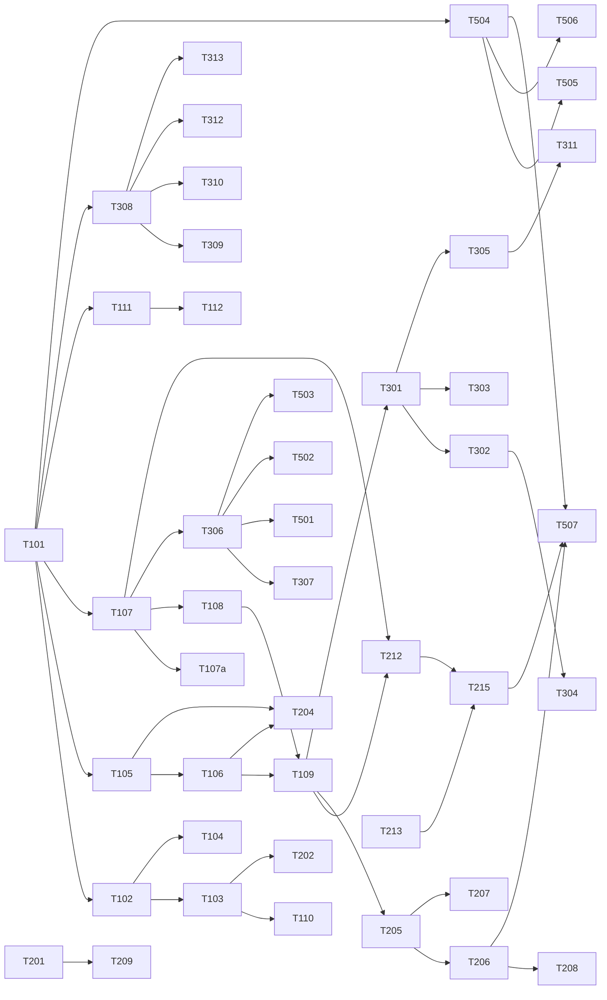

# 一期任务拆分

> 版本：1.2（2026-11-13）
> 基线：[requirements.md](./requirements.md)（v1.2）· [design.md](./design.md)（v1.2）
> 说明：任务粒度以「可独立开发、可独立测试、可独立评审」为准；依赖用前置任务 ID 表示。

---

## 1. 里程碑（修订：中继前移，M2 出口可达成）

| 里程碑 | 内容 | 出口条件 |
|---|---|---|
| M1 平台底座 | 身份、会话、项目、主机注册、凭证签发、审计写入 | 登录与凭证接口可用；单测与集成测试通过 |
| M2 连接通路 | 中继部署 + 路由同步 + 客户端选路 + 项目视图接入 | 直连与中继两条路径都能打开项目 |
| M3 策略与管控面 | 方法级授权、导出拦截、Web 管控面、403 门禁 | 下载拦截与越权防护验收通过 |
| M4 多平台与运维 | macOS/Windows/CentOS7 Agent、监控、压测、灰度 | AC-01 ~ AC-32 全部通过 |

---

## 2. 任务列表

### M1 平台底座

| ID | 任务 | 交付物 | 依赖 | 验收 |
|---|---|---|---|---|
| T101 | 平台 API 骨架与 OpenAPI 契约（列表一律分页） | `cloud-platform/api`、`openapi.yaml` | — | 契约 lint 通过 |
| T102 | LDAP/AD 登录与锁定 | `auth` 模块、LDAPS 客户端 | T101 | AC-01、AC-02 |
| T103 | 会话与令牌（访问/刷新/**会话纪元**/吊销） | `session` 模块、Redis | T102 | AC-16、AC-25 |
| T104 | 用户与组同步、角色映射与按用户覆盖 | `users` 模块、同步任务 | T102 | 角色正确；覆盖留审计 |
| T105 | 项目登记、校验、归档/恢复 | `projects` 模块 | T101 | AC-04 |
| T106 | 项目 ACL、可见性过滤（统一 404） | `grants` 模块 | T105 | AC-03、AC-12 |
| T107 | 主机注册令牌与注册（含 E2EE 公钥、TLS 指纹） | `hosts` 模块 | T101 | 重复注册被拒；公钥入库 |
| T107a | 主机公钥变更检测与强提示联动 | 平台比对 + 客户端事件 | T107 | AC-29 |
| T108 | 心跳、地址表、离线判定、撤销集合下发 | 心跳接口、状态机 | T107 | AC-08 |
| T109 | 连接凭证签发（绑定 workspaceRoot + devicePubKey）与 JWKS 轮换 | `credentials` 模块、KMS 接入 | T106, T108 | 凭证可独立验签；AC-31 |
| T110 | 设备列表与吊销接口 | `/v1/me/devices` | T103 | 设备吊销即时生效 |
| T111 | 审计事件模型与**单写入序列**写入服务 | `audit-writer`、哈希链、锚点 | T101 | AC-26 |
| T112 | 审计查询与异步导出 | 查询接口、导出任务 | T111 | AC-13 |
| T113 | 平台 API 集成测试 | 测试套件 | T102–T112 | 关键路径全覆盖 |

### M2 连接通路

| ID | 任务 | 交付物 | 依赖 | 验收 |
|---|---|---|---|---|
| T201 | 托管模式开关与配置下发 | `cloud-platform/config`、`/v1/client/config` | T101 | 非托管构建行为不变 |
| T202 | 客户端 API 客户端与会话安全存储 | `api-client`、Keychain/DPAPI/Secret Service | T103 | AC-16 |
| T203 | 登录页与错误/锁定态 | `components/cloud-platform/login` | T202 | AC-01、AC-02 |
| T204 | 工作台与项目列表 | `components/cloud-platform/workbench` | T105, T106 | AC-03、AC-04 |
| T205 | 选路器（TCP 预检 → 升级 → 回落 → failoverBudget） | `cloud-platform/route-selector.ts` + 单测 | T109 | AC-05、AC-06、AC-07 |
| T206 | 项目视图接入与连接状态条 | 复用 `TerminalSurface`，新增状态条 | T205 | AC-05、AC-06 |
| T207 | 连接诊断页与分层错误码映射 | `components/cloud-platform/diagnostics` | T205 | AC-07 |
| T208 | 重连退避与「平台不可用」降级提示 | 连接管理模块 | T206 | AC-20、AC-23 |
| T209 | 品牌、图标、产品名、最低版本 | 构建配置、`resources/` | T201 | AC-15 |
| T210 | 裁剪个人账号、分享、遥测 | 设置与菜单调整 | T201 | 托管模式下不可见 |
| T211 | 托管模式回归测试 | 自动化用例 | T202–T210 | 核心路径绿 |
| T212 | 平台 → 中继路由表同步接口（mTLS） | `/v1/internal/relay-routes` | T107 | 版本 + TTL 生效 |
| T213 | 中继部署与 SNI 白名单 | 配置、部署脚本 | — | AC-06 |
| T214 | 中继网络边界加固（无 CONNECT、出站白名单、默认黑洞） | 防火墙与配置 | T213 | 安全评审通过 |
| T215 | 中继路由同步消费端与陈旧策略 | 中继侧接收与缓存 | T212, T213 | 陈旧 5 分钟拒绝新连接 |

### M3 策略与管控面

| ID | 任务 | 交付物 | 依赖 | 验收 |
|---|---|---|---|---|
| T301 | 策略网关：升级期凭证验签、jti、设备登记 | Runtime 内 `policy-gateway` | T109 | AC-21、AC-30 |
| T302 | 方法 → 权限映射层（未登记默认拒绝） | dispatcher 改造 | T301 | AC-28 |
| T303 | 路径边界：写 `workspaceRoot`、读 `projectRoot`、符号链接解析 | 路径解析模块 | T301 | AC-11、AC-27 |
| T304 | 专用下载 RPC 拒绝 + 读取限速与记账 | RPC 拦截点 | T302 | AC-10 |
| T305 | 策略包签名与 Agent 下发 | `policies` 模块、Agent 拉取 | T301 | AC-17 |
| T306 | Agent：注册、心跳、撤销、审计上报（断网缓冲、幂等） | `cloud-platform/agent` | T107, T108 | AC-08、AC-14 |
| T307 | Agent：Runtime 守护、维护模式 | 进程管理 | T306 | AC-09 |
| T308 | Web 前端骨架、鉴权门禁、403 页 | SPA 工程、路由守卫 | T101 | AC-18 |
| T309 | 管控面：主机管理页 | 页面 + 联调 | T107, T308 | 注册命令、详情、维护/下线 |
| T310 | 管控面：项目与授权页（含归档、项目级策略） | 页面 + 联调 | T106, T305, T308 | 授权矩阵可用 |
| T311 | 管控面：下载策略页 | 页面 + 联调 | T305 | AC-17 |
| T312 | 管控面：审计日志页（筛选 + 分页 + 导出） | 页面 + 联调 | T112 | AC-13 |
| T313 | WAF 路径规则：外网仅放行认证与项目/connect | 网关配置 | T101 | AC-32 |

### M4 多平台与运维

| ID | 任务 | 交付物 | 依赖 | 验收 |
|---|---|---|---|---|
| T501 | macOS Agent（launchd）与 Runtime 部署 | 安装包、plist | T306 | macOS 主机可注册并连接 |
| T502 | Windows Agent（服务、`runProcess`/`spawnProcess`）与路径适配 | 安装程序 | T306 | Windows 主机可注册并连接 |
| T503 | CentOS 7 容器化 Runtime（seccomp、tini、bind mount、容器内路径） | 镜像 + 部署脚本 | T306 | 容器主机可打开项目 |
| T504 | 平台部署（K8s、DB、Redis、KMS、WORM） | Helm/清单 | T101 | 环境可复现 |
| T505 | 备份与恢复演练（PostgreSQL、审计存储） | 演练记录 | T504 | RPO ≤ 15 分钟，RTO ≤ 2 小时 |
| T506 | 监控、日志、告警（含链校验、路由陈旧、时钟偏差） | 指标与规则 | T504 | 告警演练通过 |
| T507 | 压测（300 并发 / 30 分钟） | 报告 | T206, T213, T504 | AC-22 |
| T508 | 安全测试（越权、穿越、重放、凭证移植、中继滥用） | 报告 | T301–T305, T214 | AC-11/21/24/27/30 |
| T509 | 灰度与回滚演练 | 演练记录 | T209, T504 | 30 分钟内回滚 |
| T510 | 运维手册与用户指引 | 文档 | 全部 | 评审通过 |

---

## 3. 依赖图

---

## 4. 风险与回滚点

| 任务 | 风险 | 回滚点 |
|---|---|---|
| T109 凭证签发 | 密钥泄露或轮换中断 | 新旧 `kid` 并行 60 天；可回滚到上一版本 |
| T205 选路器 | 预检超时不当导致频繁回落 | 超时与地址数配置化，可远程调整 |
| T304 导出拦截 | 误拦截正常工作流 | 按项目灰度；提供「仅审计不拦截」模式 |
| T214 中继 | 被当作内网跳板 | 白名单 + 默认黑洞，可随时收紧 |
| T503 CentOS 7 | seccomp / PID 1 信号问题导致启动失败 | 保留原生部署回退；镜像版本可回滚 |
| T209 客户端发布 | 旧版本无法连接 | `minClientVersion` 与回滚包 |

---

## 5. 工作量估算（人日，修订）

| 模块 | 开发 | 测试 | 合计 |
|---|---|---|---|
| 平台后端（T101–T113） | 58 | 18 | 76 |
| 连接通路（T201–T215） | 46 | 18 | 64 |
| 策略与管控面（T301–T313） | 48 | 18 | 66 |
| 多平台与运维（T501–T510） | 32 | 16 | 48 |
| 合计 | 184 | 70 | **254** |

**估算假设**：

1. 按 500 开发者、200 台开发机、300 并发会话规模；
2. 桌面客户端为 Orca 上游 + 补丁层，含上游同步缓冲约 10%；
3. 不含设计评审、项目管理与业务方沟通；
4. 不含二期能力（审批流、浏览器面板、移动端、容器化开发机）；
5. 三平台 Agent 采用共享核心 + 平台适配层，未按三套独立实现估算。

> 修订说明：v1.0 估算 176 人日为漏项口径（缺三平台 Agent、中继路由同步、审计写入服务、方法级授权、备份恢复），已按补齐后的任务重估为 254 人日。
